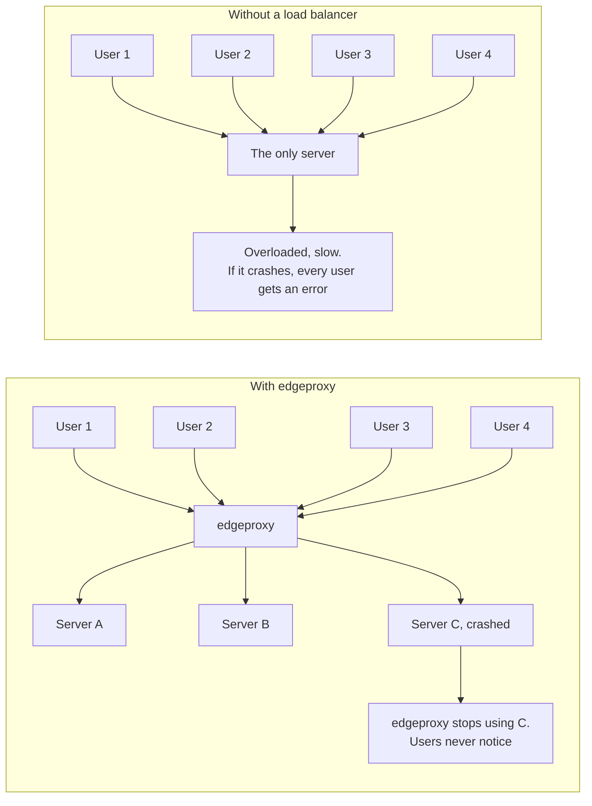
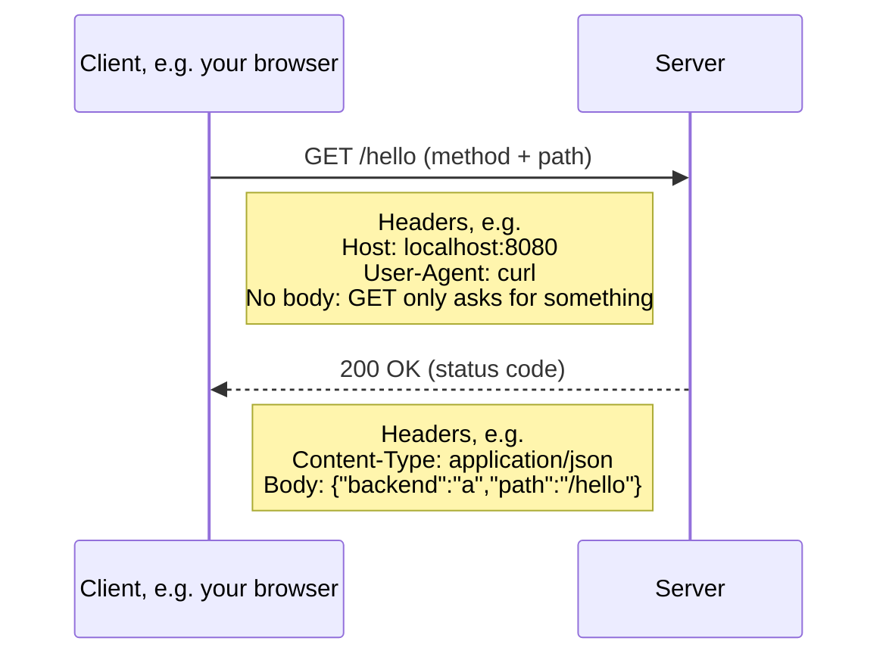
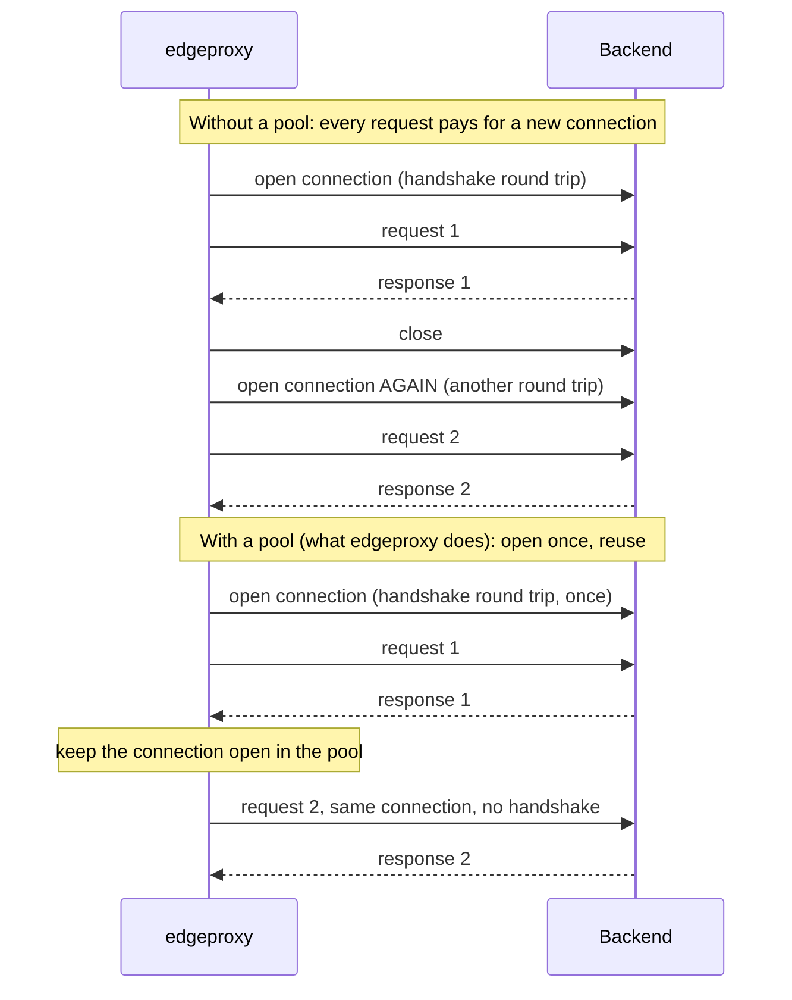
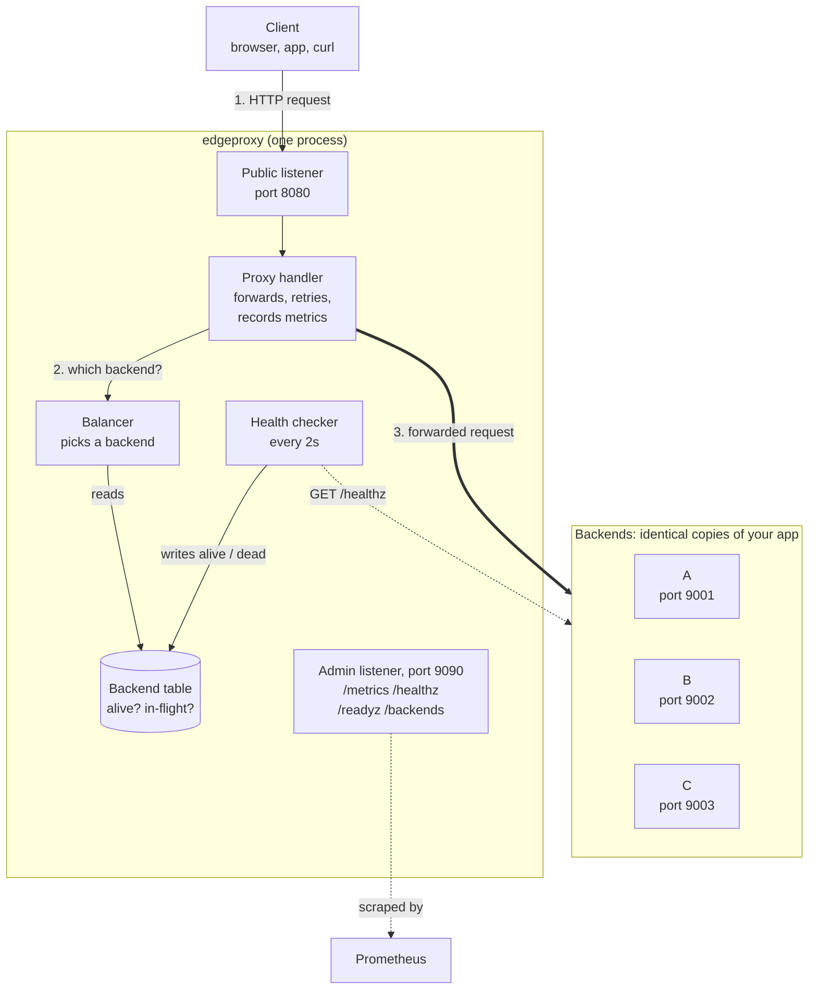
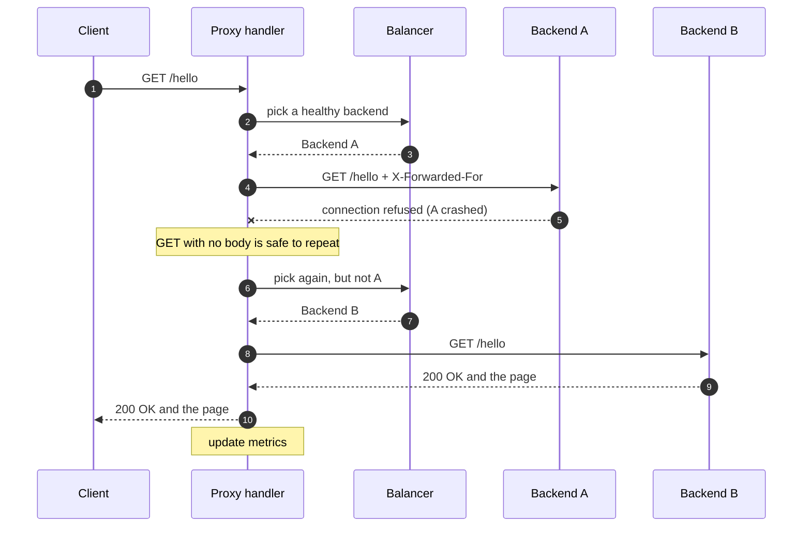
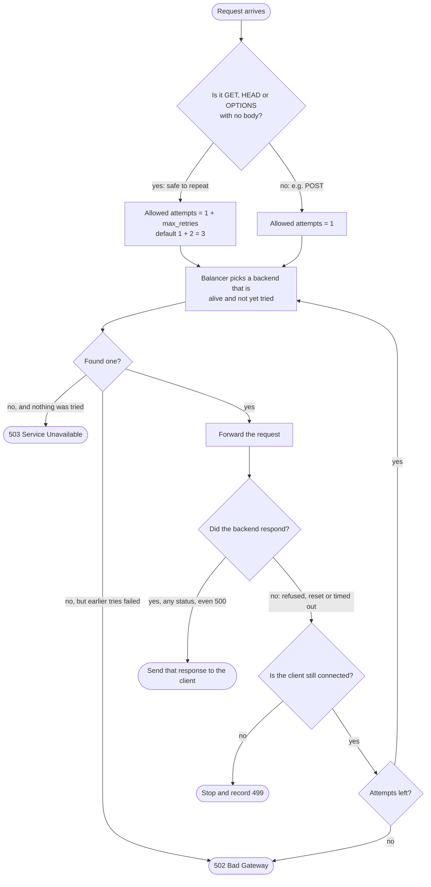
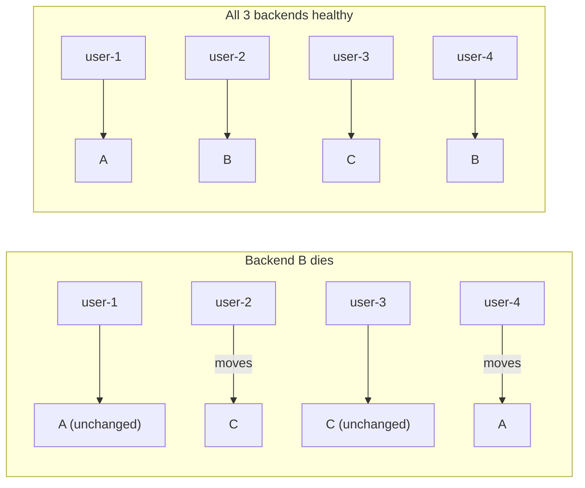
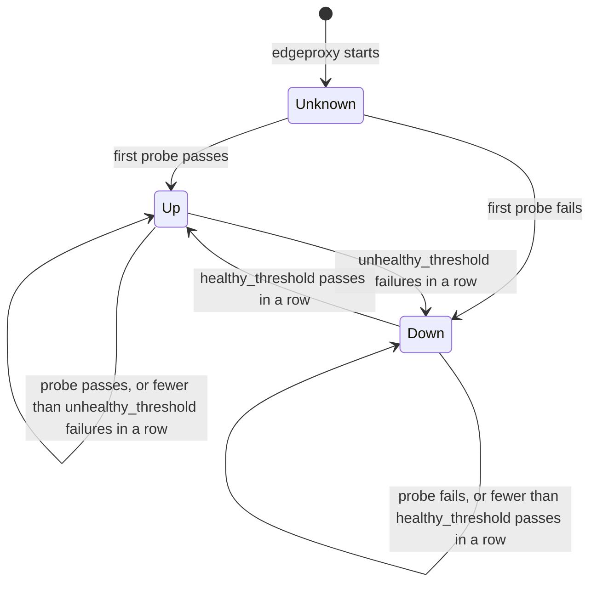
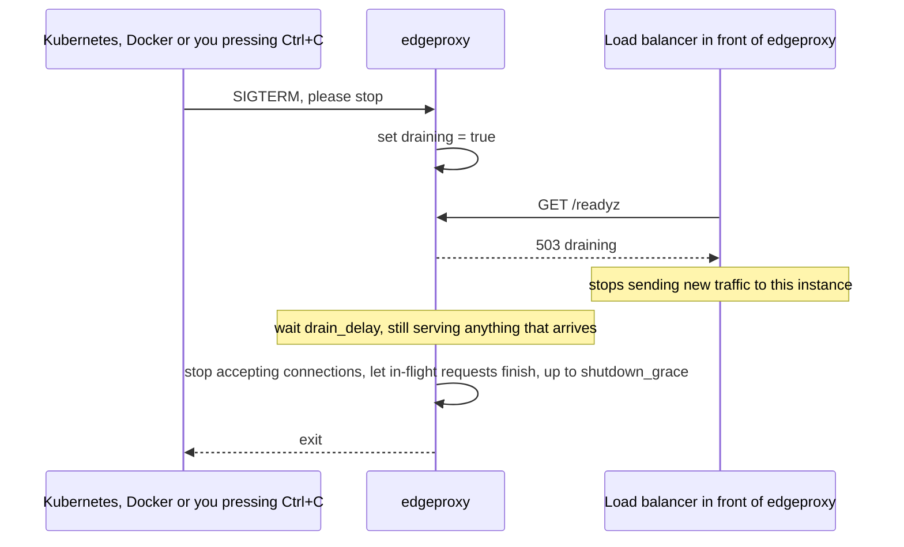
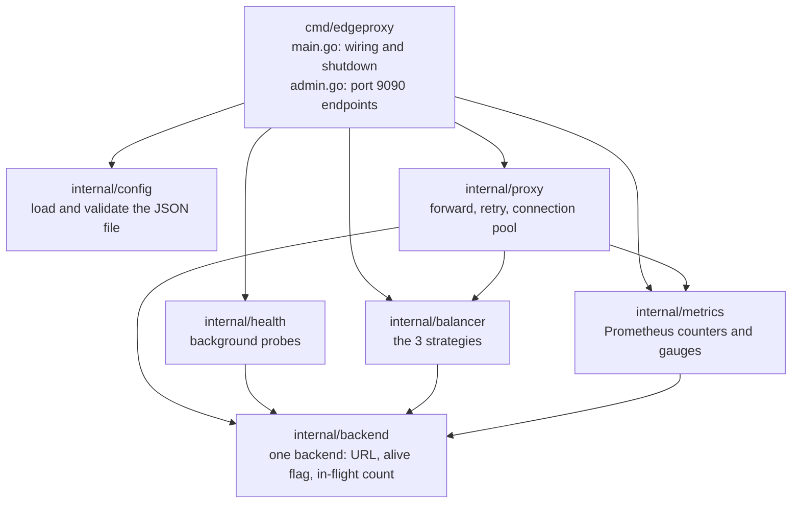

# edgeproxy

**edgeproxy is a load balancer.** It sits in front of several copies of a web
server and decides which copy handles each incoming request. If one copy
crashes, users don't notice, because edgeproxy stops sending traffic to it and
retries on a healthy one.

It's written in Go and built the way real production load balancers (Nginx,
Envoy, AWS ALB) work, at a size you can read in an afternoon.
See [PLAN.md](PLAN.md) for the roadmap: rate limiting, tracing, load tests and chaos tests.

---

## Contents

1. [The 30-second version (a bank analogy)](#1-the-30-second-version-a-bank-analogy)
2. [Words you need first](#2-words-you-need-first)
3. [The whole system in one picture](#3-the-whole-system-in-one-picture)
4. [Life of a request, step by step](#4-life-of-a-request-step-by-step)
5. [When does it retry?](#5-when-does-it-retry)
6. [How a backend is chosen (the 3 strategies)](#6-how-a-backend-is-chosen-the-3-strategies)
7. [Health checking: how a dead server is detected](#7-health-checking-how-a-dead-server-is-detected)
8. [Shutting down without dropping requests](#8-shutting-down-without-dropping-requests)
9. [Where each piece lives in the code](#9-where-each-piece-lives-in-the-code)
10. [Run it locally](#10-run-it-locally)
11. [Config file, every field explained](#11-config-file-every-field-explained)
12. [Admin endpoints and metrics](#12-admin-endpoints-and-metrics)
13. [Continuous integration](#13-continuous-integration)

---

## 1. The 30-second version (a bank analogy)

### The problem this solves

A website usually starts as **one server**: one program on one machine that
answers every user. That breaks in two ways: too many users overload it, and
if it crashes, *everyone* sees an error.



The fix is to run **several identical copies** of the server and put
edgeproxy in front of them. Users only ever talk to edgeproxy, which shares the
work out and steers around any copy that breaks.

### The same idea, as a bank

Picture a bank branch with one **front desk** and several **tellers**.

| In the bank | In edgeproxy |
|---|---|
| A customer walks in | A **request** arrives (someone opens a web page or calls an API) |
| The front desk sends each customer to a teller | **edgeproxy** forwards each request to a **backend** server |
| Tellers | **Backends**: identical copies of your web server |
| A supervisor walks round every few seconds checking each teller is awake | The **health checker** asks every backend "are you OK?" every 2 seconds |
| A teller faints mid-conversation, so the desk sends the customer to another teller | A backend crashes, so edgeproxy **retries** the request on another backend |
| ...but only if the request is safe to repeat. "What's my balance?" is safe to ask twice; "deposit ₹5,000" is not | Only **idempotent** requests (`GET`) are retried; `POST` is not, because it might run twice |
| "Send each customer to whoever has the shortest queue" | The **least connections** strategy |
| "Customer #42 always goes to the teller who has their file" | The **consistent hashing** strategy |
| At closing time, put up a "closed" sign but finish serving the people already inside | **Graceful shutdown** with a **drain** period |
| A board on the wall counting customers served and wait times | **Metrics**, read by **Prometheus** |

Keep this picture in mind; every section below is one row of this table in more detail.

---

## 2. Words you need first

Each term is used later in this README and in the code.

### Networking basics

| Term | Plain meaning |
|---|---|
| **Client** | Whoever sends a request: a browser, a phone app, or `curl`. |
| **Server** | A program that waits for requests and answers them. |
| **Request / response** | A client sends a *request* ("give me `/hello`"); the server sends back a *response* (the page, plus a status code). |
| **HTTP** | The language web clients and servers speak. A request has a *method* (`GET`, `POST`, ...), a *path* (`/hello`), *headers* (key-value metadata) and sometimes a *body* (data, e.g. a form). |
| **Method: `GET`** | "Give me something." Reading only; it changes nothing on the server. |
| **Method: `POST`** | "Here is some data, do something with it" (place an order, send a message). It changes things on the server. |
| **Header** | A line of metadata on a request or response, such as `Content-Type: application/json`. |
| **Status code** | A 3-digit number in the response saying how it went. `200` = OK, `404` = not found, `500` = the server crashed while handling it. Codes this project uses are explained in the [table below](#status-codes-edgeproxy-can-return). |
| **Port** | A number that picks which program on a machine gets the traffic. `localhost:8080` means "this machine, port 8080". |
| **TCP connection** | The underlying "phone line" between two machines that HTTP travels over. Opening one takes a round-trip handshake, so it's slow to create and worth reusing. |
| **Latency** | How long something takes, e.g. "50 ms latency". |

Here's what a request and its response actually look like, with each part labelled:



A `POST` looks the same, except the request also carries a **body**, e.g. `{"item":"book","qty":1}`.

### Load balancing

| Term | Plain meaning |
|---|---|
| **Proxy** | A middleman program. The client talks to the proxy, and the proxy talks to the real server on the client's behalf. |
| **Reverse proxy** | A proxy that sits in front of *servers* (as opposed to a proxy that sits in front of *clients*, like a corporate web filter). Clients think they're talking to one server; really the reverse proxy is passing requests along. |
| **Load balancer** | A reverse proxy that spreads requests across several servers so no single one is overloaded and any one can fail safely. edgeproxy is one. |
| **Layer 7 (L7)** | "Understands HTTP." An L7 load balancer can read the method, path and headers and make decisions with them. A **Layer 4 (L4)** balancer only sees raw TCP connections and bytes. Names come from the 7-layer OSI networking model. |
| **Backend** (also called **upstream**) | One of the real servers behind the load balancer. Here: the 3 `demobackend` processes on ports 9001–9003. |
| **Balancing strategy** | The rule used to pick a backend for each request (see [section 6](#6-how-a-backend-is-chosen-the-3-strategies)). |
| **In-flight requests** | Requests a backend is working on right now. edgeproxy keeps a live count for each backend. |
| **Connection pool / keep-alive** | Instead of opening a new TCP connection for every request (slow), edgeproxy keeps finished connections open and reuses them. This is the single biggest performance win in a proxy. |

Why the connection pool matters, side by side:



Go's default pool keeps only **2** idle connections per backend, so under load most requests would still open new ones. edgeproxy raises that to **100** (`MaxIdleConnsPerHost` in [proxy.go](internal/proxy/proxy.go)).

### Reliability

| Term | Plain meaning |
|---|---|
| **Health check (probe)** | edgeproxy regularly sends `GET /healthz` to each backend. A `2xx` answer within the timeout = pass; anything else = fail. |
| **Healthy / alive / up** | A backend that's passing health checks and allowed to receive traffic. Opposite: **unhealthy / dead / down**. |
| **Threshold** | How many passes or failures *in a row* are needed before edgeproxy changes its mind about a backend. |
| **Flapping** | A backend bouncing rapidly between up and down because of one-off glitches. Thresholds prevent it. |
| **Retry** | Trying a failed request again, on a *different* backend. |
| **Idempotent** | Safe to do more than once with the same result. Reading your balance is idempotent; transferring money is not. Only idempotent requests are safe to retry. |
| **Timeout** | The maximum time to wait for something before giving up. |
| **Graceful shutdown** | Stopping the program *without* cutting off requests that are halfway through. |
| **Drain** | The period during shutdown when the proxy tells the outside world "don't send me new work" but keeps finishing the current work. |
| **Signal / SIGTERM** | The operating system's way of telling a program to stop. `SIGTERM` = "please stop" (what Kubernetes and Docker send). Pressing Ctrl+C sends a similar signal called `SIGINT`. |
| **Liveness** | "Is the process running at all?" If not, restart it. (`/healthz`) |
| **Readiness** | "Should this instance get traffic *right now*?" It can be alive but not ready, e.g. while draining. (`/readyz`) |

### Hashing

| Term | Plain meaning |
|---|---|
| **Hash function** | Turns any text into a big number, always the same number for the same text. `hash("user-42")` is always the same value. |
| **Consistent hashing** | A way of mapping keys (like a user ID) to backends so that when a backend is removed, *only that backend's* keys move. A naive `hash % 3` would reshuffle almost everyone. |
| **Hash ring** | Picture all possible hash values laid out round a clock face. Backends and keys are placed on that clock by their hash. |
| **Virtual node** | Each backend is placed on the ring many times (128 here), not once, so the ring is evenly covered and each backend gets a fair share. |
| **Sticky routing** | The same user always reaching the same backend. Useful when a backend keeps a cache or a session for that user. |

### Observability

| Term | Plain meaning |
|---|---|
| **Metrics** | Numbers about the system over time: requests per second, error count, latency. |
| **Prometheus** | A widely used open-source tool that **scrapes** (fetches) metrics from `/metrics` every few seconds and stores them. Grafana then draws graphs from it. |
| **Counter** | A metric that only goes up (total requests served). |
| **Gauge** | A metric that goes up and down (requests in flight right now). |
| **Histogram** | A metric that sorts measurements into buckets ("how many requests took under 10 ms, under 50 ms, ...") so you can compute percentiles. |
| **p99 (99th percentile)** | 99% of requests were faster than this. If p99 = 200 ms, 1 in 100 users waited longer than 200 ms. Big companies care more about p99 than averages, because averages hide the slow, unhappy users. |
| **Structured logs** | Log lines written as JSON (`{"level":"WARN","msg":"backend is down",...}`) so machines can search and filter them. |
| **`X-Forwarded-For`** | A header saying which client IP the request originally came from, since backends only see the proxy's IP. edgeproxy **overwrites** any value the client sends, because a client could fake it. |

### Status codes edgeproxy can return

| Code | Name | When edgeproxy sends it |
|---|---|---|
| **2xx–5xx from the backend** | (passed through) | The backend answered; edgeproxy forwards its answer unchanged, even if it's a `500`. |
| **502** | Bad Gateway | edgeproxy reached for a backend but couldn't get *any* response (connection refused, reset, or timed out) on every allowed attempt. |
| **503** | Service Unavailable | Every backend is currently marked unhealthy, so there was nobody to send the request to. |
| **499** | Client Closed Request | Not actually sent (the client is gone); it's recorded in metrics when the client hung up before an answer came back. The code is an Nginx convention. |

---

## 3. The whole system in one picture



**How to read it:** solid arrows are real user traffic; dotted arrows are background checks.

- The **public listener** (port 8080) is the front door: the only address clients know about.
- The **proxy handler** takes each request, asks the **balancer** which backend should get it, forwards it, and sends the backend's answer back to the client.
- The **balancer** only picks backends that the **backend table** says are alive.
- The **health checker** runs on its own in the background, probing each backend every 2 seconds and updating the table. It's the only thing that marks backends alive or dead.
- The **admin listener** (port 9090) is a separate door for operators and monitoring tools. It's on a different port on purpose, so the public can't read your metrics or backend list.

---

## 4. Life of a request, step by step

Here's the interesting case: backend A has just crashed, and the health checker hasn't noticed yet.



What happens at each numbered step:

1. **Client sends `GET /hello`** to edgeproxy on port 8080. The client has no idea backends exist.
2. **Proxy asks the balancer** for a backend. It passes a rule: "must be alive, and must not be one we already tried for this request".
3. **Balancer answers "A"**, because the health checker last saw A as alive.
4. **Proxy forwards the request to A.** It rewrites the address to A's, and sets `X-Forwarded-For` to the real client IP (throwing away any value the client tried to send). It reuses a pooled TCP connection if one is free.
5. **A doesn't answer**: its process is gone, so the operating system refuses the connection.
6. **Proxy checks whether a retry is safe.** It's a `GET` with no body, so repeating it can't cause harm (see [section 5](#5-when-does-it-retry)).
7. **Proxy asks the balancer again**, now excluding A.
8. **Balancer answers "B".**
9. **Proxy forwards to B.**
10. **B answers `200 OK`.**
11. **Proxy streams B's answer back to the client.** The client got a normal response and never knew A was dead.
12. **Metrics are updated:** one request counted against B with code 200, its total time recorded, one retry counted, one upstream error counted against A.

Within about 2–6 seconds the health checker also notices A is down and marks it dead, so later requests skip A on the first try.

---

## 5. When does it retry?



The four rules behind this, and why each one exists:

- **Only retry when no response came back.** If a backend answered with a `500`, that *is* an answer; edgeproxy passes it on. Retrying server errors is a Phase 2 feature with a "retry budget", because blind retries can multiply load on a struggling system (a "retry storm").
- **Never retry `POST`.** The first backend might have processed the order *and then* crashed before replying. Retrying would place the order twice.
- **Never retry a request with a body.** The body was already read and sent to the first backend; it can't be replayed.
- **Each retry goes to a different backend.** Retrying the same dead server is pointless.

---

## 6. How a backend is chosen (the 3 strategies)

Set with `"strategy"` in the config. All three skip dead backends automatically.

### Round robin (`round_robin`, the default)

Take turns: A, B, C, A, B, C... Simple and fair when every backend is equally fast.
It uses a single atomic counter (a number many threads can increment safely without locks), so it costs almost nothing per request.

```
request:   1   2   3   4   5   6   7
backend:   A   B   C   A   B   C   A
```

### Least connections (`least_conn`)

Send the request to whichever backend has the **fewest in-flight requests** right now: the shortest queue at the bank.
If B is slow, requests pile up on it, its count rises, and new requests flow to A and C instead. Round robin would keep feeding B its full share.

```
in flight now:   A = 3    B = 7 (slow)    C = 2
next request  →  C
```

Ties are broken by starting the scan at a random backend, so ties don't all land on A.

### Consistent hashing (`consistent_hash`)

The same **key** (by default the client's IP; or a header such as `X-User-ID`) always goes to the same backend. That's **sticky routing**, useful when a backend caches data for a user.

How it works:

1. Every backend is placed on a "clock face" (the **hash ring**) 128 times, at positions given by hashing `"127.0.0.1:9001#0"`, `"127.0.0.1:9001#1"`, ... These are **virtual nodes**.
2. The request's key is hashed onto the same clock.
3. From that point, walk clockwise to the first virtual node that belongs to an alive backend. That's the one.

```
                        12 o'clock
                    A ●           ● B
               C ●                     ● A        ● = a virtual node
                                                  ✕ = where "user-42" lands
             B ●                         ● C
                          ✕ ──────┐
               A ●                ▼    ● B     walk clockwise from ✕
                    C ●           ● B  ◄──     first node is B → send to B
                         6 o'clock
```

**Why not just `hash(key) % 3`?** Because if a backend dies, `% 3` becomes `% 2` and almost *every* user moves to a different backend, wiping all the caches at once. With a ring, only the dead backend's users move:



The test `TestConsistentHashMovesOnlyFailedBackendsKeys` proves this with 20,000 keys: nobody on A or C moves.

---

## 7. Health checking: how a dead server is detected

Every `interval` (2 s in `configs/local.json`), the health checker sends `GET /healthz` to every backend at once. A probe **passes** if the backend answers with a `2xx` status within `timeout`; anything else (an error status, a redirect, no answer, too slow) **fails**.

A backend's state only changes after several results agree in a row:



- **Why thresholds?** One slow probe during a garbage-collection pause shouldn't eject a perfectly good server. Requiring, say, 3 failures in a row prevents **flapping**.
- **Why does the very first result count immediately?** So that on startup edgeproxy doesn't wait several intervals before sending any traffic. It also probes all backends *before* opening port 8080, so the first users never hit a dead server.
- **Active vs. passive checks.** This is *active* checking: edgeproxy goes and asks. Phase 2 adds *passive* checking: noticing real requests failing and ejecting the backend straight away, without waiting for the next probe.

Each state change is written to the log:

```json
{"level":"WARN","msg":"backend is down","backend":"127.0.0.1:9001","error":"health check returned status 503"}
{"level":"INFO","msg":"backend is up","backend":"127.0.0.1:9001"}
```

---

## 8. Shutting down without dropping requests

When you deploy a new version, the old process is told to stop. Done badly, users in the middle of a request get errors. edgeproxy does it in stages:



1. **Signal arrives** (`SIGTERM` or Ctrl+C).
2. **`/readyz` starts returning `503`.** Whatever sits in front of edgeproxy (a cloud load balancer, a Kubernetes Service) checks readiness regularly, sees the 503 and stops routing new users here.
3. **Wait `drain_delay`.** The thing in front needs a few seconds to notice. Meanwhile edgeproxy keeps serving normally. (0 s locally, since nothing is in front; around 5–10 s in Kubernetes.)
4. **Close the doors and finish up.** Stop accepting new connections and give in-flight requests up to `shutdown_grace` (15 s) to complete.
5. **Exit.**

---

## 9. Where each piece lives in the code



An arrow means "uses". Everything points down towards `backend`, the shared piece of state.

| File | What it does |
|---|---|
| [cmd/edgeproxy/main.go](cmd/edgeproxy/main.go) | Reads config, builds every piece, runs the first health check, starts both listeners, handles shutdown. |
| [cmd/edgeproxy/admin.go](cmd/edgeproxy/admin.go) | The port-9090 endpoints: `/metrics`, `/healthz`, `/readyz`, `/backends`. |
| [cmd/demobackend/main.go](cmd/demobackend/main.go) | A toy backend for testing. Can add latency, fail a percentage of requests, and toggle its own health. |
| [internal/backend/backend.go](internal/backend/backend.go) | One backend's URL, its alive flag and its in-flight counter. Uses atomics (thread-safe numbers) because the proxy and health checker touch them at the same time. |
| [internal/balancer/roundrobin.go](internal/balancer/roundrobin.go) | Round robin. |
| [internal/balancer/leastconn.go](internal/balancer/leastconn.go) | Least connections. |
| [internal/balancer/consistenthash.go](internal/balancer/consistenthash.go) | Hash ring with 128 virtual nodes per backend, and the hash-key options. |
| [internal/health/checker.go](internal/health/checker.go) | Probes, thresholds, up/down logging. |
| [internal/proxy/proxy.go](internal/proxy/proxy.go) | The request handler: the logic in sections 4 and 5, plus the tuned connection pool. |
| [internal/metrics/metrics.go](internal/metrics/metrics.go) | Defines every Prometheus metric. |
| [internal/config/config.go](internal/config/config.go) | Defaults, loading, and validation of the config file. |
| `*_test.go` | Tests next to the code they test. |

---

## 10. Run it locally

You need **Go 1.26 or newer** ([download](https://go.dev/dl/)).

Download dependencies, then run the tests:

```bash
go mod tidy
```

```bash
go test ./...
```

Start three demo backends, each in its own terminal. `b` is slow and `c` fails 10% of requests, so there's something to see:

```bash
go run ./cmd/demobackend -addr :9001 -name a
```

```bash
go run ./cmd/demobackend -addr :9002 -name b -latency 50ms
```

```bash
go run ./cmd/demobackend -addr :9003 -name c -fail-rate 0.1
```

Start the proxy in a fourth terminal:

```bash
go run ./cmd/edgeproxy -config configs/local.json
```

Send some traffic. Run this a few times and watch `"backend"` rotate through a, b, c:

```bash
curl -s localhost:8080/hello
```

### Experiments to try

| Try this | What you'll see | Which section explains it |
|---|---|---|
| `curl -X POST localhost:9001/toggle-health`, wait 4 s, then `curl -s localhost:9090/backends` | Backend a shows `"alive": false`, and traffic only goes to b and c | [7](#7-health-checking-how-a-dead-server-is-detected) |
| Press Ctrl+C in backend b's terminal, then send several `curl`s | Every request still succeeds: the proxy retries on another backend | [4](#4-life-of-a-request-step-by-step), [5](#5-when-does-it-retry) |
| Change `"strategy"` to `"consistent_hash"`, restart the proxy, run `curl -s -H "X-User-ID: 42" localhost:8080/` repeatedly | The same backend every time. Change 42 to 43 and you may get a different one | [6](#6-how-a-backend-is-chosen-the-3-strategies) |
| `curl -s localhost:9090/metrics \| grep edgeproxy_` | The live counters | [12](#12-admin-endpoints-and-metrics) |
| `curl -s -H "X-Forwarded-For: 6.6.6.6" localhost:8080/` | `x_forwarded_for` shows your real IP, not 6.6.6.6 | [2](#observability) |

---

## 11. Config file, every field explained

The config is JSON. Any field you leave out uses its default. A misspelled field name is rejected at startup with an error, rather than silently ignored.

| Field | Default | Meaning |
|---|---|---|
| `listen` | `":8080"` | Address and port the public listener accepts client traffic on. `":8080"` means every network interface, port 8080. |
| `admin_listen` | `":9090"` | Address and port for the admin endpoints. Must differ from `listen`. |
| `strategy` | `"round_robin"` | `round_robin`, `least_conn` or `consistent_hash` ([section 6](#6-how-a-backend-is-chosen-the-3-strategies)). |
| `hash_key` | `"client_ip"` | Only used by `consistent_hash`. `"client_ip"` hashes on the caller's IP; `"header:X-User-ID"` hashes on that header (falling back to IP when it's missing). |
| `max_retries` | `2` | How many *other* backends a failed safe request may be retried on (0–10). |
| `backends` | (required) | List of backend URLs, e.g. `"http://127.0.0.1:9001"`. |
| `health_check.path` | `"/healthz"` | Path probed on each backend. |
| `health_check.interval` | `"5s"` | Time between probe rounds. |
| `health_check.timeout` | `"1s"` | A probe slower than this fails. Must not exceed `interval`. |
| `health_check.healthy_threshold` | `2` | Passes in a row needed to mark a down backend up. |
| `health_check.unhealthy_threshold` | `3` | Failures in a row needed to mark an up backend down. |
| `timeouts.dial` | `"2s"` | Max time to open a TCP connection to a backend. |
| `timeouts.read_header` | `"5s"` | Max time a client gets to send its request headers. Stops a "slowloris" attack, where a client opens many connections and sends headers one byte at a time to tie the server up. |
| `timeouts.response_header` | `"10s"` | Max time a backend gets to *start* answering. |
| `timeouts.idle_conn` | `"90s"` | How long an unused pooled connection to a backend is kept open. |
| `timeouts.drain_delay` | `"0s"` | How long to keep serving after `SIGTERM` while `/readyz` reports 503 ([section 8](#8-shutting-down-without-dropping-requests)). |
| `timeouts.shutdown_grace` | `"15s"` | Max time in-flight requests get to finish during shutdown. |

Durations are strings: `"250ms"`, `"5s"`, `"1m"`.

---

## 12. Admin endpoints and metrics

All on port 9090.

| Endpoint | Answers | Used by |
|---|---|---|
| `GET /healthz` | `200 ok` whenever the process is running | **Liveness** probe: restart edgeproxy if this fails |
| `GET /readyz` | `200 ready`, or `503` while draining or when no backend is alive | **Readiness** probe: stop sending traffic here if this fails |
| `GET /backends` | JSON list of every backend with `alive` and `inflight` | Humans debugging |
| `GET /metrics` | Every metric in Prometheus text format | Prometheus scraping |

### The metrics

| Metric | Type | What it tells you |
|---|---|---|
| `edgeproxy_requests_total{backend, code}` | counter | Requests finished, by which backend answered and the status code. Divide 5xx by total for your **error rate**. |
| `edgeproxy_request_duration_seconds{backend}` | histogram | How long requests took, end to end including retries. Use it for **p50 / p99 latency**. |
| `edgeproxy_upstream_errors_total{backend}` | counter | Times a backend couldn't be reached at all (refused, reset, timed out). |
| `edgeproxy_retries_total` | counter | Attempts made on a second or third backend. A sudden rise means a backend is failing. |
| `edgeproxy_backend_up{backend}` | gauge | `1` = passing health checks, `0` = down. Alert if every backend is `0`. |
| `edgeproxy_backend_inflight_requests{backend}` | gauge | Requests that backend is handling right now. One backend much higher than the others = it's slow. |

Labels in `{braces}` split a metric into separate series; `backend="127.0.0.1:9001"` is one series per backend. `backend="none"` appears on 503s, where no backend was available.

There are also standard Go runtime metrics (`go_*`, `process_*`): memory, goroutines, CPU.

---

## 13. Continuous integration

Every push to `main` and every pull request runs [.github/workflows/ci.yml](.github/workflows/ci.yml) on Linux:

| Step | What it catches |
|---|---|
| `gofmt -l .` | Code that isn't in Go's standard formatting |
| `go mod tidy` + `git diff` | `go.mod` / `go.sum` out of date with the imports |
| `go vet ./...` | Common mistakes the compiler allows (wrong format strings, copied locks, ...) |
| `go build ./...` | Anything that doesn't compile |
| `go test -race ./...` | Failing tests, plus **data races**: two goroutines touching the same memory at once without protection. The race detector needs a C toolchain, which is why it runs in CI rather than on Windows. |
