# edgeproxy

**In one sentence:** edgeproxy is a smart front door for an app's servers.
Every user's request comes to it first, and it sends each one to a server
that is free and working, so the app stays fast and keeps running even when
a server breaks.

---

## Start here (no experience needed)

This part uses no technical word without explaining it. If you have ever used
an app or a website, you can follow it.

### What is a "backend"?

When you open an app, say a food-delivery app, two parts are working:

- The **frontend** is what you see and tap: the buttons, the pictures, the menu.
- The **backend** is a program running on a computer somewhere else, called a
  **server**. It does the real work: it checks your password, finds
  restaurants near you, and saves your order.

Every time you tap something, your phone sends a small message to the backend
asking for something. That message is a **request**. The backend sends back an
answer, called a **response**.

```
 You tap "Show restaurants"   ──── request ────►   backend (the server)
 You see the list             ◄─── response ────   backend
```

### The problem

A new app usually has **one** backend server. That works for 10 users. But:

- When **10,000 people** tap at the same moment, one server gets **too busy**, and the app becomes slow for everyone.
- If that one server **crashes**, the app stops working for **everyone**.

### The fix: several copies, and a smart front door

Run several identical copies of the backend. Now someone has to decide which
copy answers each request. **That is edgeproxy's job.** It stands at the front
door: every request comes to it first, and it passes each one to a copy that is
free and working.

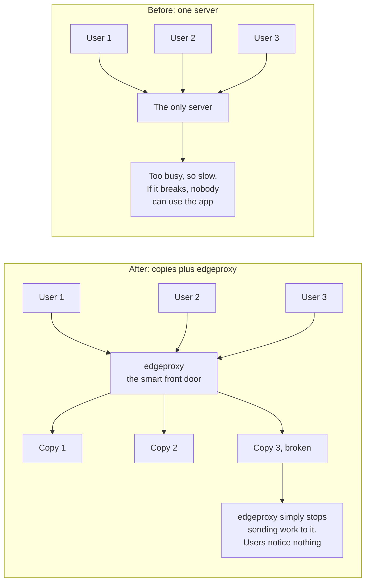

Users never know there are copies, and they never know one broke.

A program that does this is called a **load balancer**: "load" means work, and
a "balancer" shares it out evenly. Google, Amazon and Netflix all run load
balancers in front of their servers. edgeproxy is a small but real one.

### The 8 jobs edgeproxy does

Think of a bank. edgeproxy is the **manager at the front desk**, and the
backend copies are the **tellers** (the bank staff behind the counters).

| # | Job | In the bank | In edgeproxy |
|---|---|---|---|
| 1 | **Share the work** | Sends each customer to a teller who isn't busy | Sends each request to a backend copy. It knows 5 different ways to choose. |
| 2 | **Check everyone is OK** | Every few seconds, checks that each teller is at their desk | Every few seconds, asks each copy "are you OK?". It stops using any copy that doesn't answer. |
| 3 | **Bench a struggling worker** | A teller who keeps making mistakes is sent on a short break, then given one customer to see if they're better | A copy that keeps giving error answers gets no work for a while, then is tested with one request |
| 4 | **Try again, but only when it's safe** | If a teller suddenly faints, the customer is taken to another teller. But only for safe things like "check my balance", never "send money", which could then happen twice. | If a copy suddenly stops answering, the request is sent to another copy, but only if doing it twice can't cause harm |
| 5 | **Stop one person hogging everything** | "Each customer may visit at most 5 times a minute" | **Rate limiting:** a user who sends too many requests is told "slow down, try again in a few seconds" |
| 6 | **Give every visit a ticket number** | The number is written on every form the customer touches | Every request gets an ID, so you can later find out exactly what happened to it |
| 7 | **Keep a scoreboard** | A board showing customers served and waiting times | Live charts: how many requests, how fast, how many errors |
| 8 | **Change plans without closing** | Opens a new counter while the bank stays open. At closing time, puts up a "closed" sign but still serves everyone already inside. | Settings can change while it runs. When it's shut down, it first finishes every request in progress. |

It also **locks the door**: it can talk to users over **HTTPS** (the padlock
in your browser's address bar), so nobody in between can read their data.

### One request's journey

1. You tap a button. Your phone sends a request to edgeproxy.
2. edgeproxy gives the request a ticket number and notes the time.
3. It checks that you haven't sent too many requests in the last few seconds.
4. It picks a backend copy that is working and not too busy.
5. It passes your request to that copy. If that copy suddenly stops answering, and repeating the request is safe, it quickly tries another copy.
6. The answer comes back to you. edgeproxy writes one line in its diary (called a **log**): your ticket number, which copy answered, and how long it took.

edgeproxy's own part of this usually takes about **1 to 2 milliseconds**
(thousandths of a second).

### How do we know it really works?

Claims are easy; proof is better. Every time the code changes, GitHub's
computers automatically:

1. Run **91 automatic tests**, small programs that check each part does exactly what it should.
2. Start the real edgeproxy and real backend copies, and send them real requests.
3. Send **1,000 requests every second** for 30 seconds and measure the speed.
4. Then **break things on purpose** while it's busy: switch off one backend copy, make another one very slow, and unplug the database it uses for rate limits.

Result: out of **30,001 requests** sent while things were breaking, **not a
single one failed.** Users would have noticed nothing.

### Can I use it with my own app?

Yes. If you build a full-stack app (a frontend plus a backend), edgeproxy goes
between them:

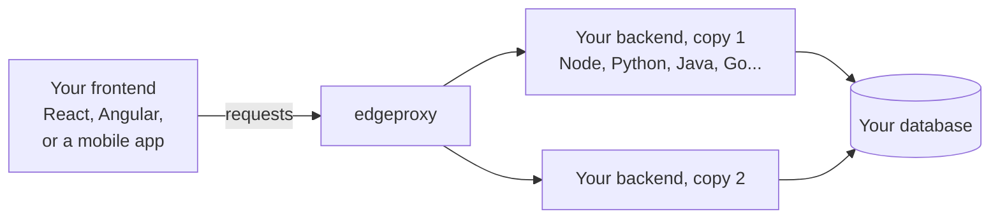

1. Your frontend sends its requests to edgeproxy's address instead of straight to the backend.
2. You run two or more copies of your backend, and list their addresses in edgeproxy's settings file.
3. Your backend should give the same answer whichever copy handles a request. So keep users, logins and shopping carts in the **database** (or Redis), not in one server's memory. A backend built this way is called **stateless**.
4. Give your backend a `/healthz` page that just answers "ok", so edgeproxy can check it's alive.

Your frontend and backend code don't need to know edgeproxy exists.

**Is edgeproxy a microservice?** A **microservice** is one small program that
does one job and talks to other programs over the network. Big apps are often
split into many of them: a users service, an orders service, a payments
service. edgeproxy is a separate program like that, and its one job is
sitting in front of the others. Programs with this role are called **reverse
proxies** or, when they also check things like rate limits, **API gateways**.
Right now edgeproxy sends every request to one group of copies. Sending
`/users` to one group and `/orders` to another is the natural next feature
([DESIGN.md](DESIGN.md) explains how).

### Where to go next

| If you are... | Read |
|---|---|
| New to backend | Keep reading this file in order. Every technical word is explained in [section 2](#2-words-you-need-first). |
| Preparing for interviews | [DESIGN.md](DESIGN.md) (why each decision was made) and [BENCHMARKS.md](BENCHMARKS.md) (the measured numbers) |
| Wanting to run it yourself | [Section 15](#15-run-it) |
| Curious how it was built, step by step | [PLAN.md](PLAN.md) |

---

## For engineers: what's inside

A Layer-7 HTTP load balancer in Go, built the way production ones (Nginx,
Envoy, AWS ALB) work, at a size you can read in a weekend:

- **5 balancing strategies:** round robin, smooth weighted round robin, least connections, power of two choices, consistent hashing
- **Two kinds of health checking:** active probes plus passive circuit breakers (outlier detection)
- **Safe retries** for idempotent requests only, capped by a retry budget
- **Rate limiting** shared across every proxy through Redis (atomic Lua sliding window), falling back to local token buckets when Redis is down
- **Observability:** Prometheus metrics, JSON access logs, request IDs, OpenTelemetry tracing, a Grafana dashboard and SLO burn-rate alerts
- **Operations:** hot config reload, DNS service discovery, TLS with HTTP/2 and certificate rotation, graceful shutdown, Docker and Kubernetes manifests
- **Proof:** unit, fuzz, end-to-end, load and chaos tests, all in CI with the race detector

Measured on a laptop: **3,000 req/s at 1.4 ms p50 / ~6 ms p99**, and **zero
failed requests out of 30,001** while a backend was killed, another slowed by
500 ms and Redis stopped, all mid-load ([BENCHMARKS.md](BENCHMARKS.md)).

---

## Contents

0. [Start here (no experience needed)](#start-here-no-experience-needed)
1. [The bank analogy, in detail](#1-the-bank-analogy-in-detail)
2. [Words you need first](#2-words-you-need-first)
3. [The whole system in one picture](#3-the-whole-system-in-one-picture)
4. [What happens to every request, layer by layer](#4-what-happens-to-every-request-layer-by-layer)
5. [Life of a request when a backend has just crashed](#5-life-of-a-request-when-a-backend-has-just-crashed)
6. [When does it retry? (and the retry budget)](#6-when-does-it-retry-and-the-retry-budget)
7. [How a backend is chosen (5 strategies)](#7-how-a-backend-is-chosen-5-strategies)
8. [Health checking: active probes and circuit breakers](#8-health-checking-active-probes-and-circuit-breakers)
9. [Rate limiting](#9-rate-limiting)
10. [Changing config without a restart](#10-changing-config-without-a-restart)
11. [Seeing inside: metrics, logs and traces](#11-seeing-inside-metrics-logs-and-traces)
12. [HTTPS (TLS)](#12-https-tls)
13. [Shutting down without dropping requests](#13-shutting-down-without-dropping-requests)
14. [Where each piece lives in the code](#14-where-each-piece-lives-in-the-code)
15. [Run it](#15-run-it)
16. [Config file, every field explained](#16-config-file-every-field-explained)
17. [Admin endpoints and metrics](#17-admin-endpoints-and-metrics)
18. [Testing and CI](#18-testing-and-ci)

---

## 1. The bank analogy, in detail

Start here compared edgeproxy to a bank in 8 jobs. Here is the full comparison, with the real technical name for each idea, so you can match the story to the terms used in the rest of this page.

Picture a bank branch with one **front desk** and several **tellers**.

| In the bank | In edgeproxy |
|---|---|
| A customer walks in | A **request** arrives (someone opens a web page or calls an API) |
| The front desk sends each customer to a teller | **edgeproxy** forwards each request to a **backend** server |
| Tellers | **Backends**: identical copies of your web server |
| A supervisor walks round every few seconds checking each teller is awake | The **health checker** asks every backend "are you OK?" every few seconds |
| A teller who is awake but keeps getting things wrong is sent on a break, then given one customer on trial | **Outlier detection** (a *circuit breaker*) ejects a backend that keeps failing real requests, then lets it back in on trial |
| A teller faints mid-conversation, so the desk sends the customer to another teller | A backend crashes, so edgeproxy **retries** the request on another backend |
| ...but only if the request is safe to repeat. "What's my balance?" is safe to ask twice; "deposit ₹5,000" is not | Only **idempotent** requests (`GET`) are retried; `POST` is not, because it might run twice |
| If half the tellers faint, the desk doesn't make every customer queue three times | The **retry budget** caps retries so a failure can't snowball |
| "Each customer may visit at most 5 times a minute", enforced at every branch | **Rate limiting**, shared across every edgeproxy through **Redis** |
| "Send each customer to whoever has the shortest queue" | The **least connections** and **power of two choices** strategies |
| "Customer #42 always goes to the teller who has their file" | The **consistent hashing** strategy |
| Every customer gets a ticket number that's written on every form they touch | Every request gets a **request ID** that appears in logs, traces and the backend |
| Opening a new teller window without closing the branch | **Hot reload**: change the backend list without a restart |
| At closing time, put up a "closed" sign but finish serving the people already inside | **Graceful shutdown** with a **drain** period |
| A board on the wall counting customers served and wait times | **Metrics**, read by **Prometheus** and drawn by **Grafana** |

Keep this picture in mind; every section below is one row of this table in more detail.

---

## 2. Words you need first

> **In plain words:** Every technical word used later, explained in everyday language. Skim it now, or come back whenever a word is new.

Each term is used later in this README and in the code.

### Networking basics

| Term | Plain meaning |
|---|---|
| **Client** | Whoever sends a request: a browser, a phone app, or `curl`. |
| **Server** | A program that waits for requests and answers them. |
| **Request / response** | A client sends a *request* ("give me `/hello`"); the server sends back a *response* (the page, plus a status code). |
| **HTTP** | The language web clients and servers speak. A request has a *method* (`GET`, `POST`, ...), a *path* (`/hello`), *headers* (key-value metadata) and sometimes a *body* (data, e.g. a form). |
| **Method: `GET`** | "Give me something." Reading only; it changes nothing on the server. |
| **Method: `POST`** | "Here is some data, do something with it" (place an order, send a message). It changes things on the server. |
| **Header** | A line of metadata on a request or response, such as `Content-Type: application/json`. |
| **Status code** | A 3-digit number in the response saying how it went. `200` = OK, `404` = not found, `500` = the server crashed while handling it. The ones edgeproxy itself sends are in the [table below](#status-codes-edgeproxy-can-return). |
| **Port** | A number that picks which program on a machine gets the traffic. `localhost:8080` means "this machine, port 8080". |
| **TCP connection** | The underlying "phone line" between two machines that HTTP travels over. Opening one takes a round-trip handshake, so it's slow to create and worth reusing. |
| **DNS** | The internet's phone book: it turns a name like `api.example.com` into IP addresses. |
| **Latency** | How long something takes, e.g. "50 ms latency". |

Here's what a request and its response actually look like, with each part labelled:

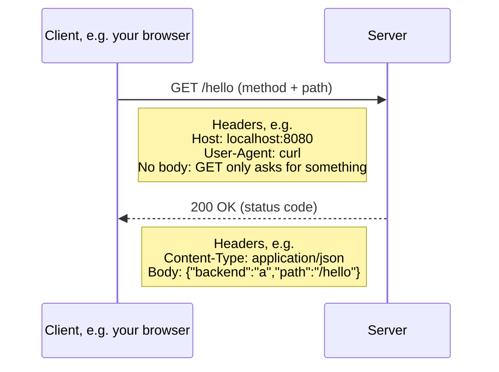

A `POST` looks the same, except the request also carries a **body**, e.g. `{"item":"book","qty":1}`.

### Load balancing

| Term | Plain meaning |
|---|---|
| **Proxy** | A middleman program. The client talks to the proxy, and the proxy talks to the real server on the client's behalf. |
| **Reverse proxy** | A proxy that sits in front of *servers* (as opposed to one in front of *clients*, like a corporate web filter). Clients think they're talking to one server. |
| **Load balancer** | A reverse proxy that spreads requests across several servers so no single one is overloaded and any one can fail safely. edgeproxy is one. |
| **Layer 7 (L7)** | "Understands HTTP." An L7 load balancer can read the method, path and headers and decide with them. A **Layer 4 (L4)** balancer only sees raw TCP connections. The names come from the 7-layer OSI networking model. |
| **Backend** (also **upstream**) | One of the real servers behind the load balancer. |
| **Balancing strategy** | The rule used to pick a backend for each request ([section 7](#7-how-a-backend-is-chosen-5-strategies)). |
| **In-flight requests** | Requests a backend is working on right now. edgeproxy keeps a live count per backend. |
| **Connection pool / keep-alive** | Instead of opening a new TCP connection for every request (slow), edgeproxy keeps finished connections open and reuses them. The single biggest performance win in a proxy. |
| **Middleware** | A layer that wraps the request handler, doing one job (give it an ID, check its rate limit, log it) before passing the request on. Layers stack like an onion. |

Why the connection pool matters, side by side:

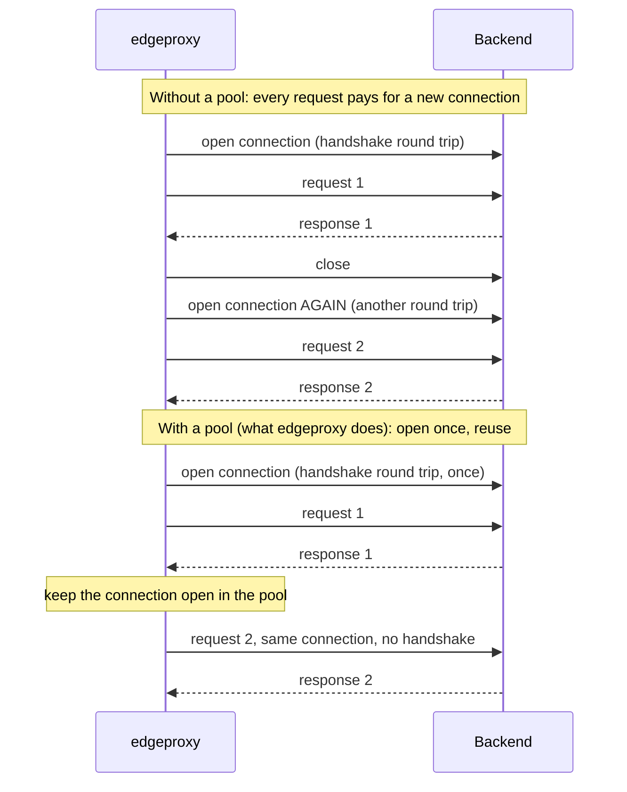

Go's default pool keeps only **2** idle connections per backend, so under load most requests would still open new ones. edgeproxy raises that to **100** (`MaxIdleConnsPerHost` in [proxy.go](internal/proxy/proxy.go)).

### Reliability

| Term | Plain meaning |
|---|---|
| **Health check (probe)** | edgeproxy regularly sends `GET /healthz` to each backend. A `2xx` answer within the timeout = pass; anything else = fail. This is **active** health checking. |
| **Healthy / up** | A backend that's allowed to receive traffic. Opposite: **unhealthy / down**. |
| **Threshold** | How many passes or failures *in a row* are needed before edgeproxy changes its mind about a backend. |
| **Flapping** | A backend bouncing rapidly between up and down because of one-off glitches. Thresholds prevent it. |
| **Outlier detection** | **Passive** health checking: watching real responses and ejecting a backend that keeps failing them, without waiting for the next probe. |
| **Circuit breaker** | The pattern outlier detection uses. *Closed* = normal, *open* = ejected (no traffic), *half-open* = let back in on trial. Named after the electrical switch that cuts power when something's wrong. |
| **Retry** | Trying a failed request again, on a *different* backend. |
| **Idempotent** | Safe to do more than once with the same result. Reading your balance is idempotent; transferring money is not. Only idempotent requests are safe to retry. |
| **Retry storm** | When every failed request is retried several times, a struggling system suddenly gets 2–3× its normal traffic, and falls over completely. |
| **Retry budget** | A cap on retries (here 20% of recent traffic) that prevents retry storms. |
| **Load shedding** | Deliberately refusing some work when overloaded, so the rest still succeeds. `max_inflight_per_backend` does this. |
| **Timeout** | The maximum time to wait for something before giving up. |
| **Graceful shutdown** | Stopping the program *without* cutting off requests that are halfway through. |
| **Drain** | The period during shutdown when the proxy tells the outside world "don't send me new work" but keeps finishing current work. |
| **Signal / SIGTERM / SIGHUP** | The operating system's way of poking a program. `SIGTERM` = "please stop" (what Kubernetes and Docker send); Ctrl+C sends the similar `SIGINT`; `SIGHUP` traditionally means "reload your config". |
| **Liveness** | "Is the process running at all?" If not, restart it. (`/healthz`) |
| **Readiness** | "Should this instance get traffic *right now*?" It can be alive but not ready, e.g. while draining. (`/readyz`) |
| **Hot reload** | Applying a new config to a running process, without restarting it or dropping a connection. |
| **Service discovery** | Finding backends automatically instead of listing them by hand. edgeproxy does it through DNS. |

### Hashing and rate limiting

| Term | Plain meaning |
|---|---|
| **Hash function** | Turns any text into a big number, always the same number for the same text. |
| **Consistent hashing** | Mapping keys (like a user ID) to backends so that when a backend is removed, *only that backend's* keys move. |
| **Hash ring / virtual node** | All hash values laid out round a clock face; each backend placed on it many times (128 here) so the clock is evenly covered. |
| **Sticky routing** | The same user always reaching the same backend. |
| **Rate limit** | A cap on how many requests one client may send in a time window, e.g. 100 per second. Over the limit, the client gets `429 Too Many Requests`. |
| **Token bucket** | A rate-limit algorithm: a bucket holds up to N tokens, refills steadily, and each request spends one. Allows short bursts but caps the average. |
| **Sliding window** | A rate-limit algorithm counting requests in "the last 60 seconds" as a moving window, so there's no burst at the boundary between minutes. |
| **Redis** | A very fast in-memory database. Here it holds the rate-limit counters that every edgeproxy instance shares. |
| **Lua script** | A small program Redis runs *atomically* (nothing else happens in between), so two proxies can't both take the last allowed request. |
| **Fail open / fail closed** | What to do when a safety system (here, Redis) breaks: *fail open* lets traffic through, *fail closed* blocks it. edgeproxy defaults to a middle ground: limit locally. |
| **LRU (least recently used)** | When memory is full, throw away whatever was used longest ago. Bounds the local rate limiter's memory. |

### Observability and security

| Term | Plain meaning |
|---|---|
| **Observability** | Being able to tell what a running system is doing from the outside: metrics, logs and traces. |
| **Metrics** | Numbers about the system over time: requests per second, error count, latency. |
| **Prometheus** | An open-source tool that **scrapes** (fetches) metrics from `/metrics` every few seconds and stores them. |
| **Grafana** | Draws graphs and dashboards from Prometheus data. |
| **Counter / gauge / histogram** | A metric that only goes up / one that goes up and down / one that sorts measurements into buckets so you can compute percentiles. |
| **p99 (99th percentile)** | 99% of requests were faster than this. Big companies watch p99 more than averages, because averages hide the slow, unhappy users. |
| **SLO (service level objective)** | A reliability target, e.g. "99.9% of requests succeed". The allowed 0.1% of failures is the **error budget**; alerts fire when it's being used up too fast (**burn rate**). |
| **Structured logs** | Log lines written as JSON so machines can search and filter them. |
| **Request ID** | A unique ID (`X-Request-ID`) given to each request and recorded everywhere it goes, so one ID finds everything about it. |
| **Trace / span** | A *trace* is the full journey of one request across services; each step in it (the proxy, each backend attempt) is a *span*, with a start time, a duration and a parent. |
| **OpenTelemetry (OTel)** | The industry-standard library and protocol (**OTLP**) for traces. **Jaeger** is one tool that stores and displays them. |
| **`traceparent`** | The W3C-standard header that carries a trace ID from service to service, so their spans join up into one trace. |
| **`X-Forwarded-For`** | A header saying which client IP a request came from. edgeproxy **overwrites** any value the client sends, because a client could fake it. |
| **TLS / HTTPS** | Encryption for HTTP. The server proves who it is with a **certificate**; **TLS termination** means edgeproxy decrypts here and talks plain HTTP to the backends on the private network. |
| **HTTP/2** | A newer version of HTTP that sends many requests over one connection at once. Browsers use it automatically over HTTPS. |

### Containers and deployment

| Term | Plain meaning |
|---|---|
| **Container / Docker** | A program packaged with everything it needs to run, so it runs the same on any machine. |
| **Image / distroless** | The packaged, read-only template a container starts from. *Distroless* images contain only the program: no shell, no package manager, so almost nothing for an attacker to use. |
| **Docker Compose** | Starts several containers together from one file (`docker-compose.yml`): here, the whole system. |
| **Kubernetes (K8s)** | A system that runs containers across many machines, restarts them when they die and scales them up and down. |
| **Pod / Deployment / Service** | A *pod* is one running copy of a container; a *Deployment* keeps N pods running and rolls out new versions; a *Service* gives pods one stable name. A **headless** Service's name resolves to every pod's own IP, which is how edgeproxy discovers them. |
| **Load test / k6** | Sending lots of realistic traffic to measure speed and find limits. *k6* is the load-testing tool used here. |
| **Chaos test** | Deliberately breaking things (killing servers, adding delays) under load to prove the system copes. |
| **CI (continuous integration)** | Every change is automatically built and tested by a server before anyone relies on it. |

### Status codes edgeproxy can return

| Code | Name | When edgeproxy sends it |
|---|---|---|
| **2xx–5xx from the backend** | (passed through) | The backend answered; edgeproxy forwards its answer unchanged, even if it's a `500`. |
| **308** | Permanent Redirect | On the optional plain-HTTP listener: "use the HTTPS address instead". |
| **429** | Too Many Requests | The client went over a rate limit. Comes with `Retry-After` saying how many seconds to wait. |
| **502** | Bad Gateway | edgeproxy couldn't get *any* response from a backend on every allowed attempt. |
| **503** | Service Unavailable | No backend can take the request: all unhealthy, ejected or at capacity. |
| **499** | Client Closed Request | Not actually sent (the client is gone); recorded in metrics when the client hung up first. An Nginx convention. |

---

## 3. The whole system in one picture

> **In plain words:** A map of every part inside edgeproxy and how the parts connect.

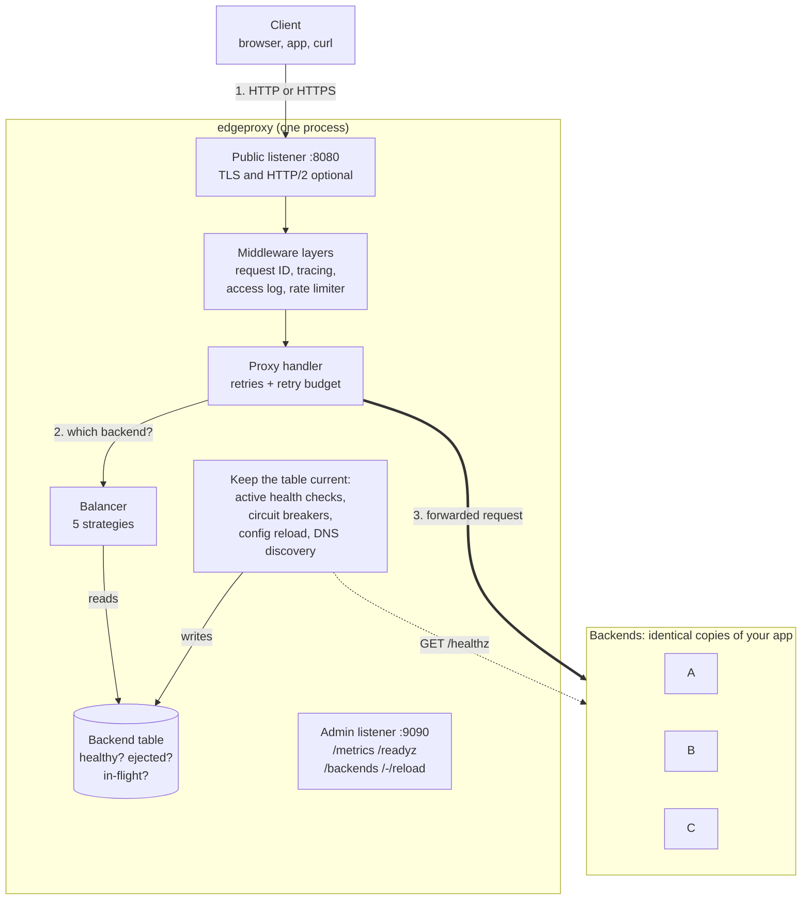

**How to read it:** solid arrows are real user traffic; dotted arrows are background work.

- The **public listener** is the front door, the only address clients know. It can speak HTTPS ([section 12](#12-https-tls)).
- The **middleware layers** run on every request before it's forwarded ([section 4](#4-what-happens-to-every-request-layer-by-layer)).
- The **proxy handler** asks the **balancer** for a backend, forwards the request, retries safely if needed, and reports every result to that backend's circuit breaker.
- Four things keep the **backend table** current: **active health checks** (probes), **circuit breakers** (real results), **config reload** and **DNS discovery**.
- Outside the process (shown in the [Docker Compose picture](#option-a-the-whole-system-with-docker-recommended)): **Redis** holds rate-limit counters shared by every edgeproxy instance, **Jaeger** receives traces, and **Prometheus** scrapes metrics from the separate **admin listener**, which is kept off the public port on purpose.

---

## 4. What happens to every request, layer by layer

> **In plain words:** Before passing a request on, edgeproxy does four quick checks, a bit like the checks at an airport.

Before a request is forwarded it passes through four middleware layers, like
going through the checks at an airport. Each does one job and passes the
request inward; the response travels back out through the same layers.

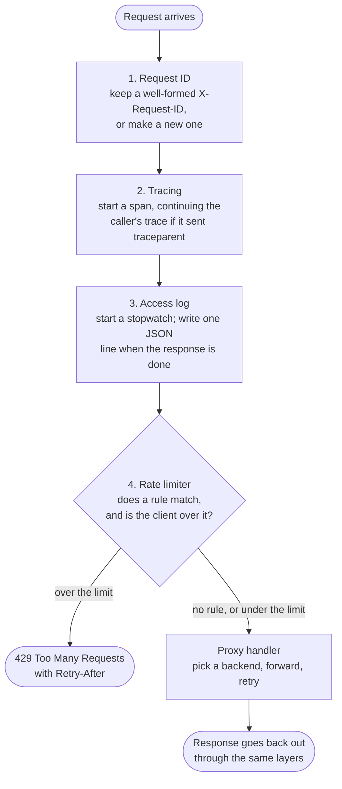

The order matters: the ID comes first so *everything* after it can record it,
and logging and tracing sit outside the rate limiter so that even rejected
(429) requests are logged and traced. See `main.go` in
[cmd/edgeproxy](cmd/edgeproxy/main.go).

---

## 5. Life of a request when a backend has just crashed

> **In plain words:** What happens, step by step, when one of the copies has just crashed.

Backend A has just crashed, and the health checker hasn't noticed yet.

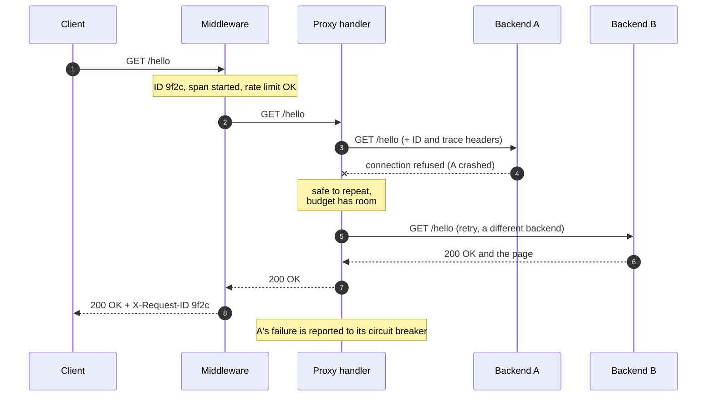

1. The request gets an ID, a trace span, and passes the rate limiter.
2. The balancer picks **A** (it hasn't been marked down yet).
3. edgeproxy forwards to A. It reuses a pooled connection if it can, and sets `X-Forwarded-For` to the real client IP, `X-Request-ID`, and a `traceparent` header so A's own logs and traces can join up.
4. **A refuses the connection.** No response came back, so nothing has been sent to the client yet.
5. It's a `GET` with no body, so repeating it is safe, and the **retry budget** has room. edgeproxy asks the balancer again, excluding A.
6. **B** answers `200 OK`, which streams back to the client with the same request ID.
7. A's failure was reported to its **circuit breaker**; a few more and A is ejected even before the health checker notices.

The access log line and the trace both record: backend B, 2 attempts, status 200.

---

## 6. When does it retry? (and the retry budget)

> **In plain words:** edgeproxy only re-sends a request when repeating it is harmless, and never so often that it makes things worse.

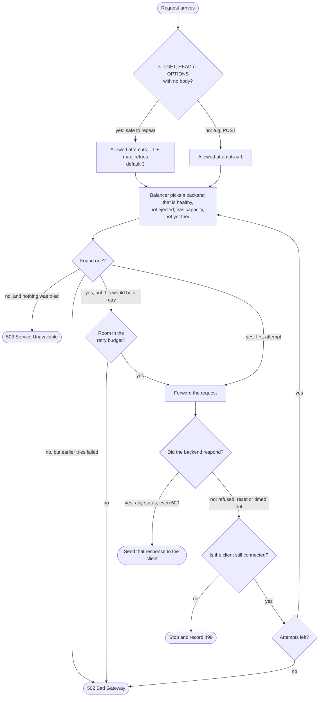

- **Only retry when no response came back.** A `500` *is* an answer, so it's passed on (and counted against that backend's circuit breaker).
- **Never retry `POST` or a request with a body.** The first backend may have done the work and crashed before replying; retrying could place an order twice.
- **Each retry goes to a different backend.**
- **The retry budget:** over the last 10 seconds, retries may be at most **20% of requests** (with a floor of 10 per second for quiet services). Without it, a broken backend makes every request try three backends, tripling load on the healthy ones exactly when they can least afford it: a *retry storm*.

```
 normal traffic           backend B breaks, no budget        backend B breaks, with budget
 100 req/s  →  100        100 req/s → up to 300 attempts      100 req/s → at most 120 attempts
                          (the healthy backends drown)        (failures stay contained)
```

---

## 7. How a backend is chosen (5 strategies)

> **In plain words:** Five different rules edgeproxy can use to decide which copy gets the next request.

Set with `"strategy"` in the config. Every strategy skips backends that are unhealthy, ejected, at capacity, or already tried for this request.

### Round robin (`round_robin`, the default)

Take turns: A, B, C, A, B, C... Simple and fair when every backend is equally fast. A single lock-free counter makes it nearly free per request.

```
request:   1   2   3   4   5   6   7
backend:   A   B   C   A   B   C   A
```

### Weighted round robin (`weighted_round_robin`)

Like round robin, but a backend with `"weight": 3` gets three times the traffic, for when some machines are bigger. It uses **nginx's smooth algorithm**, which interleaves picks rather than sending bursts:

```
weights A=5, B=1, C=1   →   A A B A C A A   (not A A A A A B C)
```

### Least connections (`least_conn`)

Send each request to the backend with the **fewest requests in flight**: the shortest queue. If B is slow, requests pile up on it, its count rises, and new requests flow elsewhere.

```
in flight now:   A = 3    B = 7 (slow)    C = 2
next request  →  C
```

### Power of two choices (`p2c`)

Pick **two backends at random** and send the request to the less busy of the two. Surprisingly, this gets nearly all of least-connections' benefit, and it avoids a trap: when many proxies all see the same "least loaded" backend, least-connections makes them all pile onto it at once. Random sampling spreads their choices out. Envoy and Twitter's Finagle use it.

```
sample:  B (7 in flight)  vs  C (2 in flight)   →  C
```

### Consistent hashing (`consistent_hash`)

The same **key** (the client's IP, or a header such as `X-User-ID`) always goes to the same backend: **sticky routing**, useful when a backend caches data per user.

1. Every backend is placed on a "clock face" (the **hash ring**) 128 times, at positions given by hashing its address plus a number. These are **virtual nodes**.
2. The request's key is hashed onto the same clock.
3. From there, walk clockwise to the first virtual node of a usable backend.

```
                        12 o'clock
                    A ●           ● B
               C ●                     ● A        ● = a virtual node
                                                  ✕ = where "user-42" lands
             B ●                         ● C
                          ✕ ──────┐
               A ●                ▼    ● B     walk clockwise from ✕
                    C ●           ● B  ◄──     first node is B → send to B
                         6 o'clock
```

**Why not just `hash(key) % 3`?** If a backend dies, `% 3` becomes `% 2` and almost *every* user moves, wiping every cache at once. With a ring, only the dead backend's users move:

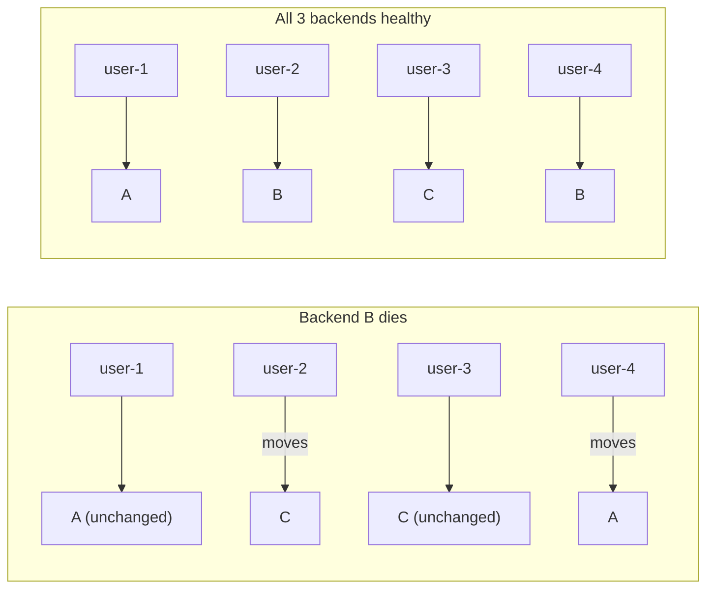

`TestConsistentHashMovesOnlyFailedBackendsKeys` proves this with 20,000 keys.

---

## 8. Health checking: active probes and circuit breakers

> **In plain words:** Two ways of spotting a broken copy: asking it how it is, and watching how it behaves.

edgeproxy finds broken backends two ways, because each catches failures the other misses.

| | **Active** health checks | **Passive** health checks (outlier detection) |
|---|---|---|
| How | Sends `GET /healthz` to every backend every `interval` | Watches the results of real requests |
| Catches | Dead or unreachable backends, even with no traffic | Backends that answer `/healthz` fine but fail real work (bad deploy, broken database connection) |
| Speed | Up to one interval × threshold | Immediately after N failures in a row |

### Active: a backend is up or down

A backend's state only changes after several probe results agree in a row:

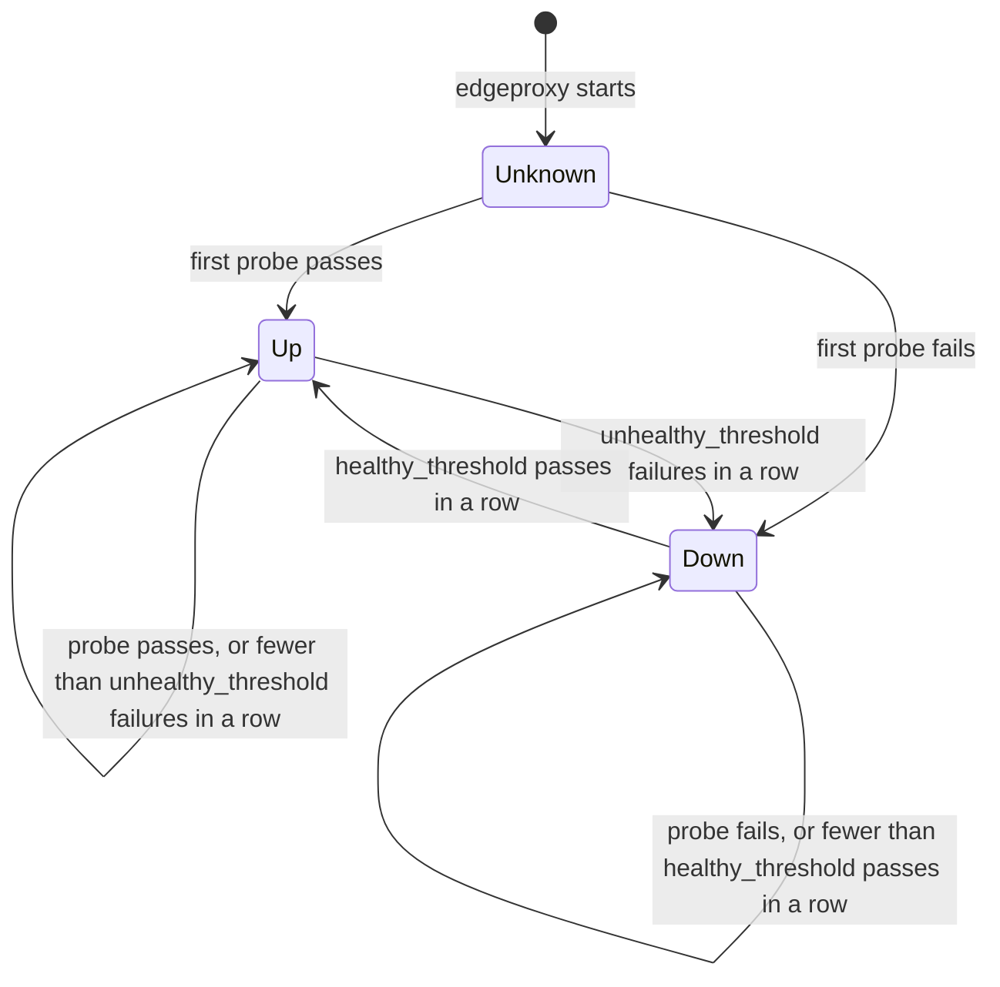

Thresholds stop one slow probe from ejecting a good server (**flapping**). The first result counts immediately, and edgeproxy probes everything *before* opening its port, so the first users never hit a dead server.

### Passive: a circuit breaker per backend

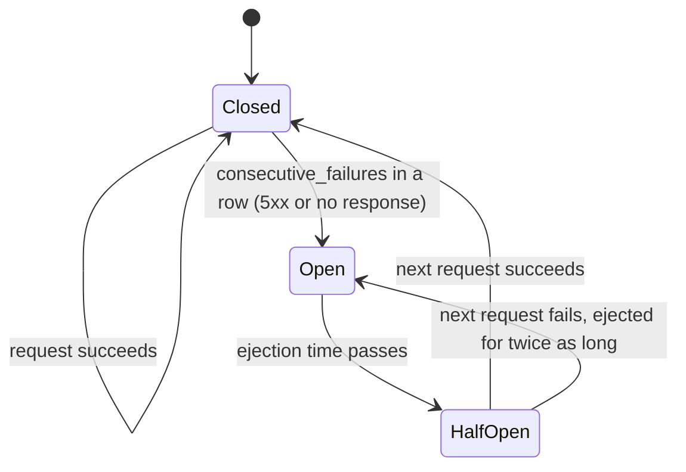

- **Closed** (normal): traffic flows. Failures in a row are counted; any success resets the count.
- **Open** (ejected): no traffic at all for the ejection time: 10 s the first time, doubling on each repeat up to 5 minutes.
- **Half-open** (on trial): traffic is allowed again; a single failure re-ejects it immediately.
- **Safety valve:** at most `max_ejection_percent` (50%) of backends can be ejected at once. If a bad deploy hits *every* backend, ejecting them all would turn "some errors" into "total outage", so edgeproxy keeps serving instead.

`/backends` shows both views, e.g. `"alive": true, "outlier": "ejected"` = passing probes but failing real traffic.

---

## 9. Rate limiting

> **In plain words:** How edgeproxy stops any one user from sending too many requests.

A rate limit caps how many requests one client may send. It protects your
servers from abusive or buggy clients, and expensive endpoints (like login)
from brute-force attacks. Rules are checked in order and the first match applies:

```json
"rules": [
  { "name": "login", "path_prefix": "/login", "methods": ["POST"], "limit": 5, "window": "1m" },
  { "name": "api",   "path_prefix": "/",      "limit": 100, "window": "1s", "key": "header:X-API-Key" }
]
```

Over the limit, the client gets `429 Too Many Requests` with a `Retry-After`
header; every limited response also carries `RateLimit-Limit`,
`RateLimit-Remaining` and `RateLimit-Reset`, so well-behaved clients can slow
down before they're cut off.

### Two algorithms

**In memory (one proxy):** a **token bucket** per client.

```
 capacity 5, refills 5 per minute (one every 12 s)

 [● ● ● ● ●]  full            each request takes one token
 [● ● ●    ]  2 requests      a token drips back every 12 s
 [         ]  empty → 429     Retry-After: 12
```

Buckets live in 16 separately locked shards (so concurrent requests rarely
wait on each other), and each shard forgets its least recently used clients
when full, so memory stays bounded however many clients appear.

**In Redis (every proxy shares the limit):** a **sliding window counter**.
Time is cut into fixed windows; "requests in the last minute" is estimated as
this window's count plus the previous window's count, weighted by how much of
it still overlaps:

```
        previous minute: 10 requests  │  this minute: 4 so far
   ───────────────────────────────────┼───────────────────
                     ◄──── 25% ─────► │ ◄──── 75% ────►   now is 45 s into the minute
                       still overlaps │
   estimated count = 10 × 0.25 + 4 = 6.5
```

The read-check-increment runs as one **Lua script inside Redis**, so it's
atomic: two proxies can never both take the last allowed request.

### What happens when Redis goes down

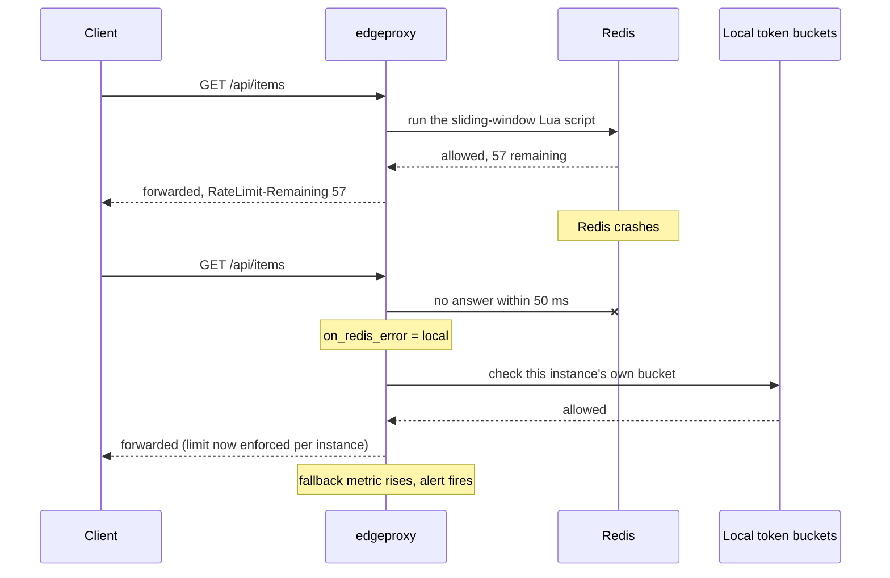

`on_redis_error` picks the trade-off: `local` (default: still limited, just
per instance), `allow` (fail open: availability first), or `deny` (fail
closed: protection first). The chaos test stops Redis under load: zero
requests failed.

---

## 10. Changing config without a restart

> **In plain words:** How you can change edgeproxy's settings while it keeps running.

Edit the config file and edgeproxy notices within `reload_interval` (2 s);
or send `SIGHUP`; or `POST /-/reload` on the admin port.

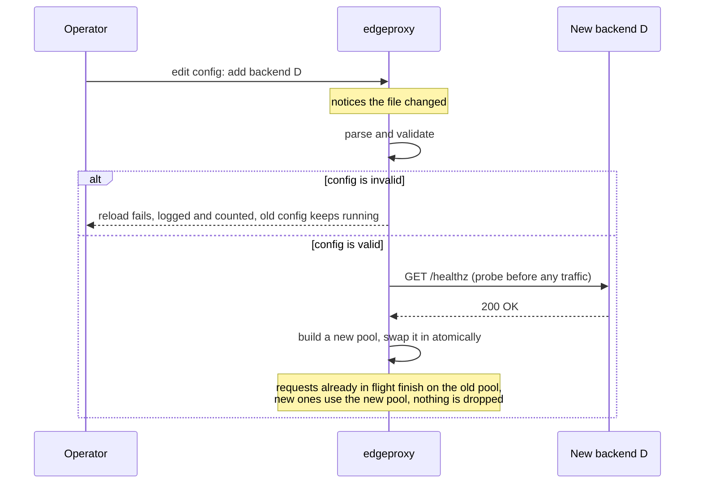

Backends that exist in both the old and new config keep their health and
circuit-breaker state. Backends, weights, strategy, health checks, outlier
detection, retries and rate-limit rules all reload live; a few settings
(listen addresses, timeouts, TLS, tracing) need a restart, and edgeproxy logs
which ones you changed.

**DNS service discovery** uses the same mechanism: list a DNS name under
`discovery.dns` and edgeproxy re-resolves it every few seconds, turning each IP
address into a backend. In Kubernetes, point it at a *headless* Service and it
finds every pod automatically. Addresses are sorted, so the hash ring stays
stable, and a failed DNS lookup keeps the last known addresses rather than
emptying the pool.

---

## 11. Seeing inside: metrics, logs and traces

> **In plain words:** How you can see what edgeproxy is doing: live charts, a diary of every request, and a timeline of each request's journey.

The three ways to see what a running system is doing, and the question each answers:

| Tool | Answers | Where |
|---|---|---|
| **Metrics** (Prometheus, Grafana) | "How is the system doing overall?" Rates, error ratios, p99 latency, health | `:9090/metrics`, Grafana dashboard |
| **Access logs** (JSON) | "What happened to *this* request?" | stdout, one line per request |
| **Traces** (OpenTelemetry, Jaeger) | "Where did the time go for this request?" | Jaeger UI |

All three share the **request ID** and **trace ID**, so you can jump from a
spike on a graph, to the log lines, to the exact trace.

An access log line:

```json
{"msg":"request","method":"GET","path":"/hello","status":200,"duration_ms":1.8,"bytes":57,
 "backend":"10.0.0.7:8080","attempts":1,"request_id":"9f2c4e...","client_ip":"203.0.113.9","trace_id":"4bf92f..."}
```

(The query string is never logged; it often carries tokens.)

A trace, as Jaeger shows it, for a request whose first attempt failed:

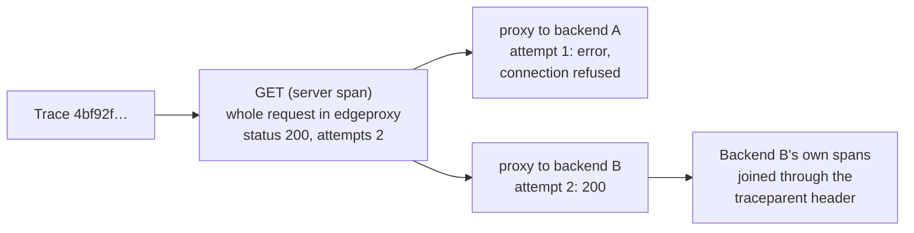

The Grafana dashboard ([deploy/grafana](deploy/grafana/dashboards/edgeproxy.json))
shows RED metrics (Rate, Errors, Duration) per backend, backend health,
retries, rate limiting and Go runtime stats. Prometheus alert rules
([deploy/prometheus/alerts.yml](deploy/prometheus/alerts.yml)) follow Google's
SRE-workbook **multi-window burn-rate** pattern for a 99.9% availability SLO,
and come with unit tests.

---

## 12. HTTPS (TLS)

> **In plain words:** How edgeproxy keeps users' data private on its way to and from the app.

Set `tls.cert_file` and `tls.key_file` and the public listener speaks HTTPS,
with HTTP/2 negotiated automatically and TLS 1.2 as the minimum (or 1.3 only).

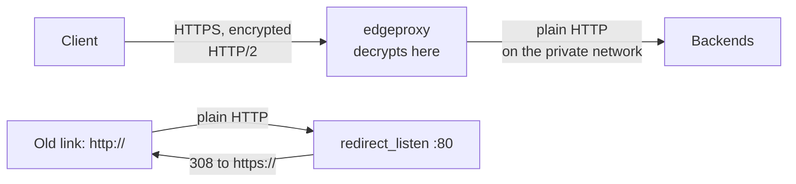

- **Certificate rotation without a restart:** certificates expire (often every 90 days). edgeproxy re-reads the files every `reload_interval`, so a renewed certificate (from cert-manager or certbot) is served to new connections immediately. A broken renewal is logged and the old certificate stays in use.
- `tls.redirect_listen` (e.g. `":80"`) answers plain HTTP with a `308` redirect to the HTTPS address.
- `edgeproxy -gen-cert ./certs` writes a self-signed localhost certificate for trying it out.

---

## 13. Shutting down without dropping requests

> **In plain words:** How edgeproxy switches off politely, finishing the work in progress first.

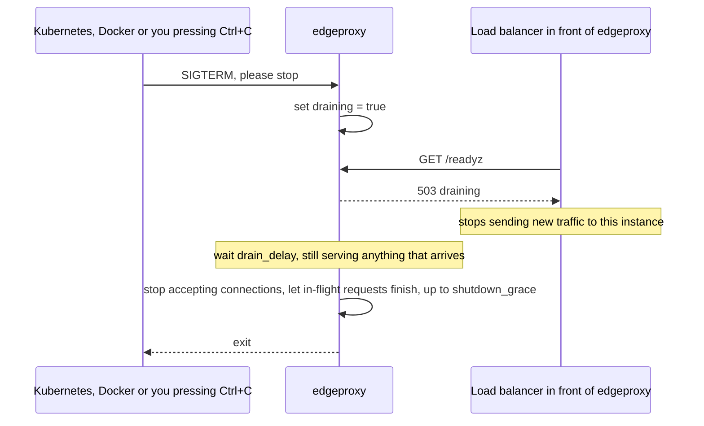

1. **Signal arrives** (`SIGTERM` or Ctrl+C).
2. **`/readyz` starts returning `503`**, so whatever sits in front stops routing new users here.
3. **Wait `drain_delay`** while it notices (0 s locally; ~5 s in Kubernetes). edgeproxy keeps serving normally meanwhile.
4. **Close the doors and finish up:** stop accepting connections; in-flight requests get up to `shutdown_grace` (15 s).
5. **Exit.** `TestGracefulShutdownFinishesInflightRequests` proves a request in progress during shutdown still gets its `200`.

---

## 14. Where each piece lives in the code

> **In plain words:** Which folder holds which part of the program.

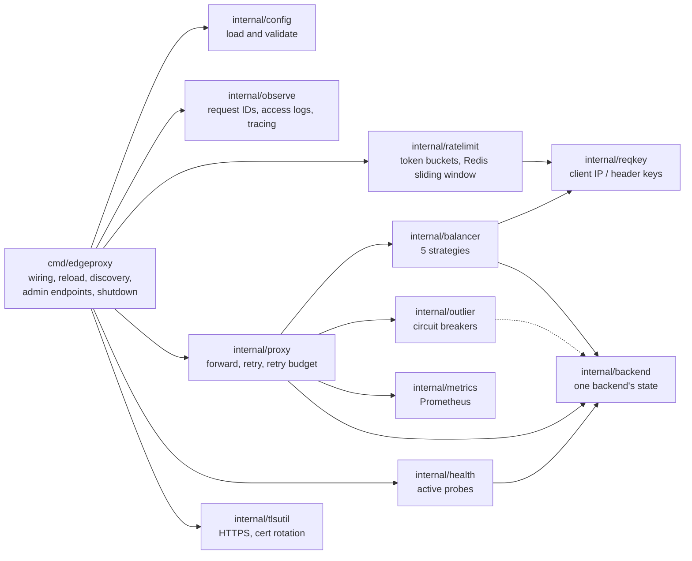

An arrow means "uses". Everything funnels down to `backend`, the shared state.

| Path | What it does |
|---|---|
| [cmd/edgeproxy/main.go](cmd/edgeproxy/main.go) | Reads config, builds every piece, stacks the middleware, starts the listeners, handles shutdown. |
| [cmd/edgeproxy/reload.go](cmd/edgeproxy/reload.go) | Hot reload: file watching, SIGHUP, building and swapping pools, cert rotation. |
| [cmd/edgeproxy/discovery.go](cmd/edgeproxy/discovery.go) | DNS service discovery. |
| [cmd/edgeproxy/admin.go](cmd/edgeproxy/admin.go) | The port-9090 endpoints. |
| [cmd/demobackend](cmd/demobackend/main.go) | A toy backend: adds latency, fails a share of requests, toggles its own health, echoes what it received. |
| [internal/proxy](internal/proxy/proxy.go) | The request handler, retries, [retry budget](internal/proxy/budget.go), connection pool, per-attempt spans. |
| [internal/balancer](internal/balancer/) | [Round robin](internal/balancer/roundrobin.go), [weighted](internal/balancer/weighted.go), [least conn](internal/balancer/leastconn.go), [P2C](internal/balancer/p2c.go), [consistent hash](internal/balancer/consistenthash.go). |
| [internal/health](internal/health/checker.go) | Active health checks. |
| [internal/outlier](internal/outlier/outlier.go) | Passive health checks: per-backend circuit breakers. |
| [internal/ratelimit](internal/ratelimit/) | [Rules and middleware](internal/ratelimit/ratelimit.go), [local token buckets](internal/ratelimit/local.go), [Redis sliding window](internal/ratelimit/redis.go). |
| [internal/observe](internal/observe/) | Request IDs, [access log](internal/observe/accesslog.go), [tracing](internal/observe/tracing.go). |
| [internal/tlsutil](internal/tlsutil/tlsutil.go) | TLS config, certificate rotation, HTTPS redirect. |
| [internal/config](internal/config/config.go) | Defaults, parsing, validation (and a [fuzz test](internal/config/fuzz_test.go)). |
| [internal/metrics](internal/metrics/metrics.go), [internal/backend](internal/backend/backend.go), [internal/reqkey](internal/reqkey/reqkey.go) | Metric definitions; one backend's state; who-sent-this keys. |
| [e2e/](e2e/) | End-to-end tests running the real binaries. |
| [deploy/](deploy/) | Compose config, Prometheus rules, Grafana dashboard, Kubernetes manifests. |
| [loadtest/](loadtest/k6/load.js), [scripts/](scripts/) | k6 load test, chaos test, benchmark, local CI. |

---

## 15. Run it

> **In plain words:** How to start edgeproxy on your own computer and try it out.

### Option A: the whole system with Docker (recommended)

You need **Docker** (Docker Desktop on Windows/macOS).

```bash
docker compose up -d --build
```

That starts all of this:

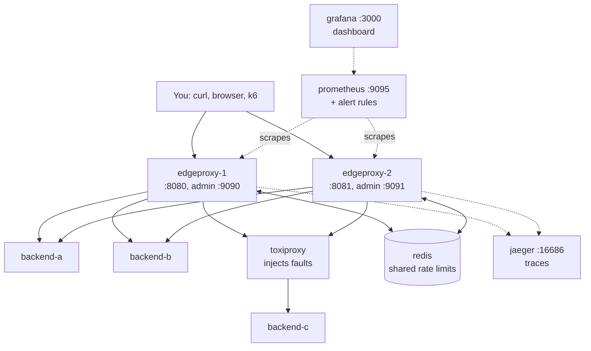

| Open | To see |
|---|---|
| http://localhost:3000 | The Grafana dashboard (send some traffic first) |
| http://localhost:16686 | Traces in Jaeger |
| http://localhost:9095/alerts | Prometheus alert rules and their state |
| http://localhost:9090/backends | edgeproxy-1's view of each backend |

Send traffic, then load-test and break things:

```bash
curl -s localhost:8080/hello
```

```bash
docker compose run --rm k6 run /scripts/load.js
```

```bash
scripts/chaos.sh
```

```bash
RATE=3000 DURATION=20s scripts/bench.sh
```

Stop it all:

```bash
docker compose down
```

### Option B: just the Go programs

You need **Go 1.26 or newer** ([download](https://go.dev/dl/)). Start three demo backends, each in its own terminal (`b` is slow, `c` fails 10% of requests):

```bash
go run ./cmd/demobackend -addr :9001 -name a
```

```bash
go run ./cmd/demobackend -addr :9002 -name b -latency 50ms
```

```bash
go run ./cmd/demobackend -addr :9003 -name c -fail-rate 0.1
```

Then the proxy:

```bash
go run ./cmd/edgeproxy -config configs/local.json
```

```bash
curl -s localhost:8080/hello
```

### Experiments to try

| Try this | What you'll see | Section |
|---|---|---|
| `curl -X POST localhost:9001/toggle-health`, wait 4 s, `curl -s localhost:9090/backends` | Backend a shows `"alive": false`; traffic skips it | [8](#8-health-checking-active-probes-and-circuit-breakers) |
| Ctrl+C backend b's terminal, then send several `curl`s | Every request still succeeds via retries | [5](#5-life-of-a-request-when-a-backend-has-just-crashed) |
| Start a backend with `-fail-rate 1` and send 20 requests | `/backends` shows it `"outlier": "ejected"` while `"alive"` is still true | [8](#8-health-checking-active-probes-and-circuit-breakers) |
| Change `"strategy"` in the config file and save | The log says `config reloaded`; no restart | [10](#10-changing-config-without-a-restart) |
| `curl -s -X POST localhost:8080/login` six times quickly | The 6th gets `429` with `Retry-After` | [9](#9-rate-limiting) |
| `curl -si localhost:8080/hello` | The response has an `X-Request-ID`; find it in the proxy's log | [11](#11-seeing-inside-metrics-logs-and-traces) |
| `curl -s -H "X-Forwarded-For: 6.6.6.6" localhost:8080/` | The backend sees your real IP, not 6.6.6.6 | [2](#observability-and-security) |
| `go run ./cmd/edgeproxy -check -config configs/local.json` | Validates a config without starting anything | [16](#16-config-file-every-field-explained) |

### Option C: Kubernetes

[deploy/k8s](deploy/k8s/) has production-style manifests:

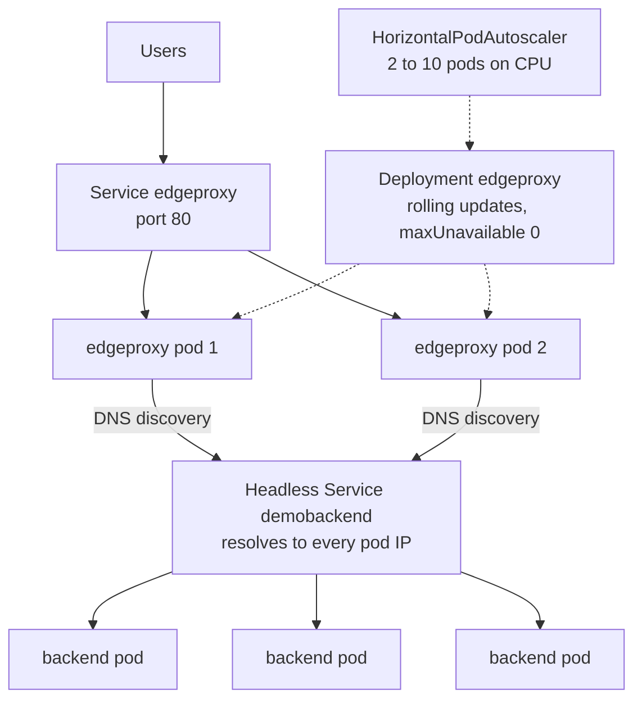

Readiness probes gate traffic (and fail during draining), a
PodDisruptionBudget keeps a replica up during node maintenance, and containers
run as non-root with a read-only filesystem and no Linux capabilities. With a
local [kind](https://kind.sigs.k8s.io/) cluster:

```bash
docker build -t edgeproxy:local . && docker build -t demobackend:local --build-arg TARGET=demobackend .
```

```bash
kind load docker-image edgeproxy:local demobackend:local
```

```bash
kubectl apply -k deploy/k8s
```

---

## 16. Config file, every field explained

> **In plain words:** Every setting in the settings file, and what it changes.

JSON; any field you leave out uses its default. Misspelled field names are rejected at startup.
Durations are strings: `"250ms"`, `"5s"`, `"1m"`. Validate a file with `edgeproxy -check -config FILE`.

### Core

| Field | Default | Meaning |
|---|---|---|
| `listen` | `":8080"` | Address for client traffic. |
| `admin_listen` | `":9090"` | Address for the admin endpoints. Must differ from `listen`. |
| `backends` | (required unless discovery is set) | Backend URLs, as strings or `{"url": "...", "weight": 3}` objects. |
| `strategy` | `"round_robin"` | `round_robin`, `weighted_round_robin`, `least_conn`, `p2c` or `consistent_hash`. |
| `hash_key` | `"client_ip"` | For `consistent_hash`: `"client_ip"` or `"header:X-User-ID"`. |
| `max_retries` | `2` | How many *other* backends a failed safe request may be retried on (0–10). |
| `max_inflight_per_backend` | `0` | Stop sending to a backend with this many requests in flight (0 = no cap). |
| `reload_interval` | `"2s"` | How often the config and TLS files are checked for changes (0 disables watching). |
| `access_log` | `true` | One JSON line per request. |

### `health_check` (active)

| Field | Default | Meaning |
|---|---|---|
| `path` | `"/healthz"` | Path probed on each backend. |
| `interval` | `"5s"` | Time between probe rounds. |
| `timeout` | `"1s"` | A probe slower than this fails. |
| `healthy_threshold` | `2` | Passes in a row to mark a down backend up. |
| `unhealthy_threshold` | `3` | Failures in a row to mark an up backend down. |

### `outlier_detection` (passive)

| Field | Default | Meaning |
|---|---|---|
| `consecutive_failures` | `5` | Eject after this many failed requests in a row (0 disables). |
| `base_ejection_time` | `"10s"` | First ejection length; doubles on each repeat. |
| `max_ejection_time` | `"5m"` | Cap on ejection length. |
| `max_ejection_percent` | `50` | Never eject more than this share of backends at once. |

### `retry_budget`

| Field | Default | Meaning |
|---|---|---|
| `ratio` | `0.2` | Retries in the last 10 s may be at most this share of requests. |
| `min_retries_per_second` | `10` | ...or this many per second, whichever is larger. |

### `rate_limit`

| Field | Default | Meaning |
|---|---|---|
| `rules[]` | none | Each: `name`, `path_prefix`, optional `methods`, `limit`, `window`, `key` (`client_ip` or `header:Name`). First match wins. |
| `redis.addr` | `""` | Redis `host:port`; empty means limits are per instance, in memory. |
| `redis.password_env` | `""` | Name of the environment variable holding the Redis password (never put it in the file). |
| `redis.db` / `redis.key_prefix` | `0` / `"edgeproxy:rl:"` | Redis database and key namespace. |
| `redis.timeout` | `"50ms"` | Give up on Redis after this long and apply `on_redis_error`. |
| `on_redis_error` | `"local"` | `local`, `allow` or `deny` ([section 9](#9-rate-limiting)). |
| `max_keys` | `100000` | Most clients the in-memory limiter tracks. |

### `tracing`, `tls`, `discovery`, `timeouts`

| Field | Default | Meaning |
|---|---|---|
| `tracing.enabled` | `false` | Export OpenTelemetry traces. |
| `tracing.endpoint` / `insecure` | `"localhost:4318"` / `true` | OTLP/HTTP collector address; `insecure` uses plain HTTP. |
| `tracing.sample_ratio` | `1` | Share of new traces kept (a caller's own sampling decision is respected). |
| `tracing.service_name` | `"edgeproxy"` | Name shown in Jaeger. |
| `tls.cert_file` / `key_file` | `""` | PEM certificate and key; set both to serve HTTPS. |
| `tls.min_version` | `"1.2"` | `"1.2"` or `"1.3"`. |
| `tls.redirect_listen` | `""` | Plain-HTTP address that redirects to HTTPS, e.g. `":80"`. |
| `discovery.dns[]` | none | Each: `host`, `port`, `scheme` (`http`/`https`); every address the name resolves to becomes a backend. |
| `discovery.interval` | `"10s"` | How often to re-resolve. |
| `timeouts.dial` | `"2s"` | Max time to open a TCP connection to a backend. |
| `timeouts.read_header` | `"5s"` | Max time a client gets to send its headers (stops "slowloris" attacks, where a client ties up connections by sending headers one byte at a time). |
| `timeouts.response_header` | `"10s"` | Max time a backend gets to *start* answering. |
| `timeouts.idle_conn` | `"90s"` | How long an unused pooled connection is kept. |
| `timeouts.drain_delay` | `"0s"` | How long to keep serving after `SIGTERM` while `/readyz` reports 503. |
| `timeouts.shutdown_grace` | `"15s"` | Max time in-flight requests get to finish during shutdown. |

See [configs/local.json](configs/local.json), [deploy/compose/edgeproxy.json](deploy/compose/edgeproxy.json) and the ConfigMap in [deploy/k8s/edgeproxy.yaml](deploy/k8s/edgeproxy.yaml) for complete examples.

---

## 17. Admin endpoints and metrics

> **In plain words:** The control-room pages and live numbers you can watch.

On the admin port (9090), never the public one:

| Endpoint | Answers | Used by |
|---|---|---|
| `GET /healthz` | `200 ok` while the process runs | Liveness probe |
| `GET /readyz` | `200 ready`, or `503` while draining or with no healthy backend | Readiness probe |
| `GET /backends` | JSON per backend: `alive`, `outlier` state, `inflight`, `weight` | Humans debugging |
| `POST /-/reload` | Re-reads config and certificates; `400` with the reason if the new config is invalid | Operators, deploy scripts |
| `GET /metrics` | Prometheus metrics | Prometheus |

| Metric | Type | What it tells you |
|---|---|---|
| `edgeproxy_requests_total{backend, code}` | counter | Requests finished, by backend and status. 5xx ÷ total = **error rate**. |
| `edgeproxy_request_duration_seconds{backend}` | histogram | End-to-end latency, for **p50 / p99**. |
| `edgeproxy_upstream_errors_total{backend}` | counter | Times a backend couldn't be reached at all. |
| `edgeproxy_retries_total` | counter | Attempts on a second or third backend. |
| `edgeproxy_retry_budget_exhausted_total` | counter | Retries refused because the budget was empty. |
| `edgeproxy_outlier_ejections_total{backend}` | counter | Circuit-breaker ejections. |
| `edgeproxy_backend_up{backend}` | gauge | `1` = passing active health checks. |
| `edgeproxy_backend_ejected{backend}` | gauge | `1` = ejected by outlier detection. |
| `edgeproxy_backend_inflight_requests{backend}` | gauge | Requests in progress on that backend. |
| `edgeproxy_rate_limited_total{rule}` | counter | Requests rejected with 429, by rule. |
| `edgeproxy_rate_limit_fallbacks_total` | counter | Times Redis failed and `on_redis_error` was applied. |
| `edgeproxy_config_reloads_total{result}` | counter | Reloads by `success` / `failure`. |

`backend="none"` appears on 503s where no backend was available. Standard Go
runtime metrics (`go_*`, `process_*`) are included too.

---

## 18. Testing and CI

> **In plain words:** How the project checks itself automatically every time the code changes.

Five kinds of tests, from smallest to biggest:

| Kind | What it checks | Where |
|---|---|---|
| **Unit tests** | One piece alone, e.g. "does smooth weighted round robin produce A A B A C A A?" | `*_test.go` next to the code |
| **Fuzz test** | Random mutations of real configs never crash the parser or slip past validation | [internal/config/fuzz_test.go](internal/config/fuzz_test.go) |
| **End-to-end tests** | The real binaries as separate processes, over real HTTP: balancing, failover, ejection, retries, rate limits (against real Redis), reload, discovery, request IDs, tracing, TLS, graceful shutdown | [e2e/](e2e/) |
| **Load test** | 1,000 req/s through the full Docker stack stays under 0.1% errors and 250 ms p99 | [loadtest/k6/load.js](loadtest/k6/load.js) |
| **Chaos test** | The same, while a backend is killed, another slowed by 500 ms, and Redis stopped | [scripts/chaos.sh](scripts/chaos.sh) |

Every push runs them all in [GitHub Actions](.github/workflows/ci.yml):

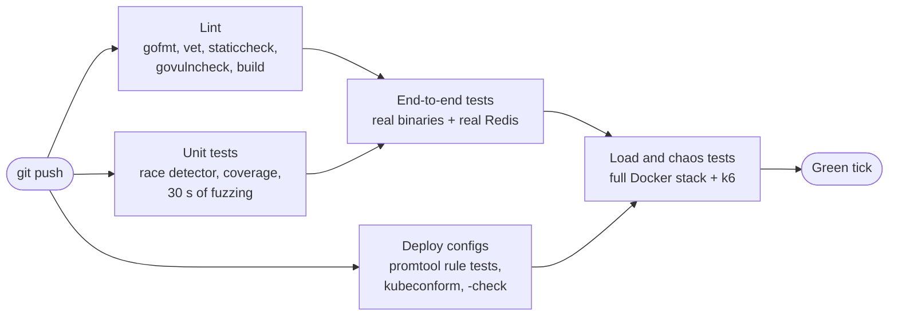

- **Race detector:** CI builds tests *and* the e2e binaries with `-race`, which catches two goroutines (Go's lightweight threads) touching the same memory unsafely.
- **govulncheck** fails the build if a known vulnerability is reachable from the code, in the standard library or any dependency.
- Run everything locally (works on Windows too, through Docker):

```bash
docker run --rm -v "$PWD:/src" -w /src golang:1.26 sh scripts/ci-local.sh
```

Or just the fast parts:

```bash
go test ./...
```

```bash
go test -tags e2e -v ./e2e/
```

The `-tags e2e` is a **build tag**: the e2e files are skipped by a plain
`go test ./...`, which keeps the everyday run fast.
